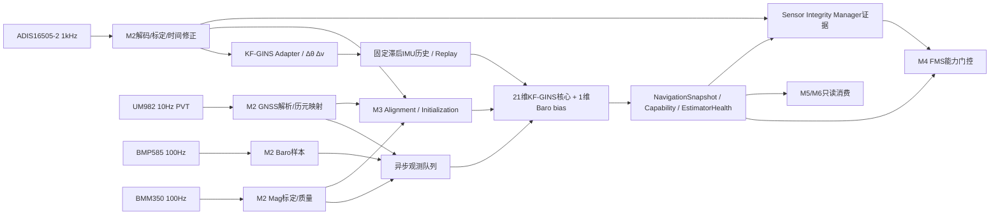

# 传感器采集时间基准、GNSS丢失降级与KF-GINS导航适配设计（V1.9.1）

> **当前硬件语义（用户2026-11-05更正）：** UM982 GNSS是主要、必装器件，UART4/DMA/PPS固定启用。本文“无GNSS/独立运行”均指已安装器件的有效观测在启动获星前或运动中暂不可用，不表示可以不安装或裁剪GNSS。为保持已有链接，文件名保留；旧可选硬件/默认关闭条款已按CR-V191-GNSS-REQUIRED-01废止。

> **规范性：** 本文件是传感器采集时间、GNSS/PPS时间语义、M2/M3导航数据链及QUAD_X4首版KF-GINS适配设计的唯一详细来源。KF-GINS内部实现细节、观测模型、初始化、延迟融合和资源约束以本文件为准；公共接口仍以02号ICD为准。


## 项目落位与官方资料入口

M2 语义在 `middleware/sensor/`，M3 调度/状态发布在 `middleware/model/ins/`，项目 KF-GINS Port/适配在 `middleware/model/ins/kf_gins/`，Sensor Integrity 在 `middleware/sensor/`。可替换算法后端随使用方整体归档（KF-GINS 在 `middleware/model/ins/kf_gins/`）；器件原厂 SensorAPI 内联进 `sensor_device/` 的对应驱动文件；板级共享第三方包（CMSIS/HAL/CMSIS-Driver）仍在 `packages/`。采集复用 `libraries/HAL_Drivers/` 和 `board/`，不重新生成 SPI/I2C/UART/Timer/DMA 驱动。目录/构建唯一见03 §0，以下路径均相对 Flight 根。

| 设备/输入 | 本地官方资料或用例 | 后续接入边界 |
|---|---|---|
| 硬件清单 | [`doc/Flight.xlsx`](../doc/Flight.xlsx) | 与现有 `.ioc`、初始化、驱动配置和07核对，不改写工作簿 |
| ADIS16505 | [数据手册](../doc/ADIS16505/adis16505.pdf)、[no-OS 器件逻辑](../doc/ADIS16505/no-OS/drivers/imu/adis1650x.c)、[官方用例](../doc/ADIS16505/no-OS/projects/eval-adis1650x/) | 按实际型号核对寄存器/Burst/时序；实际驱动为 `sensor_device/imu/adis16505.c`，传输回调适配现有 SPI，DRDY/TIM2/DMA 资源归板级驱动 |
| BMM350 | [数据手册](../doc/BMM350/BMM350.pdf) | 原厂 SensorAPI 已内联进 `sensor_device/mag/bmm350.c`（保留 `LICENSE`）；复用现有 I2C 设备链路，寄存器事务归驱动，单位/安装旋转归M2 |
| BMP585 | [数据手册](../doc/BMP585/bst-bmp585-ds003.pdf) | 原厂 SensorAPI 已内联进 `sensor_device/barometer/bmp585.c`（保留 `LICENSE`）；按实际配置接入已有总线，采样时序/补偿与标定边界分清；不重新生成总线驱动 |

`doc/` 保持资料/用例属性，不直接编译 no-OS 全工程或运行其中 STM32/CubeMX 生成脚本。当前 UM982 等未列本地官方资料的设备应显式补齐来源，不把其他型号资料当作等价依据。

## 历史追溯索引（仅记录已归并来源；原文件不再是实施依据）

- `19_传感器采集_DMA_缓冲与中断设计.md`
- `20_统一时间同步与数据对齐规范.md`
- `21_传感器完整性与FDIR规范.md`
- `42_GNSS可选能力与无GNSS导航运行规范.md`

---

## 原文归并：19_传感器采集_DMA_缓冲与中断设计.md

<sub>来源文件：`19_传感器采集_DMA_缓冲与中断设计.md`</sub>


## 19 --- 传感器采集、DMA、缓冲与中断设计

**适用平台：** STM32H723 / Cortex-M7 / RTOS\
**所属架构层：** PLATFORM / DRIVERS\
**设计目标：** 保证采样事件可追踪、DMA 不丢数、RTOS
调度抖动不污染采样时间，并以有界缓冲隔离生产者和消费者。

### 1. 设计原则

1.  采样时间由硬件事件或传感器时钟确定，不能由 RTOS 任务运行时间决定。
2.  DMA 负责搬运，不能把 DMA 完成时刻当成采样时刻。
3.  ISR 只做最小工作，不在中断里做业务处理。
4.  DMA buffer 和后续 sample ring 分层，短期 DMA buffer 尽快释放。
5.  高频 IMU 通道独立，不能被低频传感器、日志或通信阻塞。
6.  所有缓冲有固定容量、有所有权、有 overflow 策略。
7.  缓冲区深度由最坏调度延迟、输入速率和突发量计算，不凭经验选取。
8.  对 H723 必须显式处理 DMA 可访问 SRAM 和 Cortex-M7 D-Cache 一致性。

### 2. 硬件采集事件

#### 2.1 DRDY 触发

传感器输出新样本或 FIFO 达到 watermark 时产生 DRDY。推荐信号链：

``` text
Sensor DRDY / FIFO watermark
    -> Timer Input Capture (preferred)
    -> EXTI/NVIC ISR
    -> record capture event + sequence
    -> start/confirm DMA
```

如果板级引脚可路由到定时器输入捕获，优先使用硬件 capture，避免 ISR
响应延迟进入事件时间戳。若只能使用 EXTI ISR 读取 timer
counter，则必须测量中断响应时间及最大抖动，并把它计入时间不确定度。

#### 2.2 DRDY 不等于物理测量中心时刻

DRDY 表示数据寄存器/FIFO 可读，不必然代表物理测量没有延迟。传感器内部
ADC、数字滤波、过采样、FIFO 和 decimation 可能引入流水线延迟。M2拥有每种传感器的采样时刻模型；Time Service只提供时钟转换，不另存一份传感器延迟：

`t_sample = t_event_capture - calibrated_sensor_pipeline_delay`

若传感器提供内部 timestamp/sample
counter，应优先使用其时间信息并映射到飞控时钟。模型和延迟值必须由数据手册与台架测量确认。

### 3. 采集方式选择

  -------------------------------------------------------------------------
  传感器类型         推荐方式                  时间戳策略
  ------------------ ------------------------- ----------------------------
  高频 IMU，支持     FIFO watermark + SPI      每样本用内部计数器或 ODR
  FIFO               burst DMA                 重建时间

  高频 IMU，无 FIFO  DRDY + SPI DMA            硬件 capture
                                               DRDY；补偿内部延迟

  GNSS UART          UART circular DMA +       使用 GNSS 解算时间；不能用
                     IDLE/帧完成               UART DMA 完成时间替代

  Barometer          DRDY 或定时触发 +         使用转换完成/测量 epoch
                     DMA/总线读取              和转换延迟模型

  Magnetometer       DRDY/FIFO 或低频轮询      使用设备采样时间或捕获事件

  Optical            设备时间戳/数据就绪中断   保留积分区间和测量中心时刻
  Flow/Rangefinder                             
  -------------------------------------------------------------------------

不同设备不应强行采用同一种采集方式。

### 4. ISR 设计

#### 4.1 DRDY ISR 允许操作

-   读取或接收硬件 capture 时间；
-   读取设备实例 ID 和必要状态；
-   更新中断/事件序号；
-   触发 DMA 或记录待处理 acquisition request；
-   提交固定大小事件/descriptor；
-   使用 RTOS 允许的轻量机制唤醒指定 worker。

#### 4.2 ISR 禁止操作

-   传感器滤波、标定、矩阵运算和 ESKF；
-   printf、格式化日志和文件写入；
-   动态内存分配；
-   阻塞队列、等待 DMA 或等待总线；
-   长时间持有锁；
-   复杂协议解析。

#### 4.3 DMA Completion ISR

DMA 完成中断只需： 1. 记录 `t_dma_complete`； 2. 检查 DMA 错误标志； 3.
仅在RX/TX DMA完整且SPI EOT成立时将descriptor转为READY（先到事件只置位）； 4. 通知 acquisition
worker； 5. 退出。

不能在 DMA ISR 中直接运行完整 M2 滤波或 INS 更新。

### 5. DMA Buffer Pool 与 Descriptor Ring

#### 5.1 Buffer 所有权状态机

``` text
FREE
  -> OWNED_BY_DMA
  -> READY
  -> PROCESSING
  -> FREE
```

-   DMA 正在写入时 CPU 不得读取。
-   descriptor READY 后 acquisition worker 才能取得 buffer。
-   PLATFORM acquisition worker 处理/复制期间 DMA 不得复用该 buffer；M2
    不持有 DMA buffer。
-   PLATFORM acquisition worker 完成原始 payload 复制后显式 release DMA
    buffer。
-   每次 buffer 复用增加 generation，防止旧 descriptor 指向已复用
    buffer。
-   缓冲区句柄使用
    `buffer_id + generation`，公共模块接口不传递长期裸指针。

#### 5.2 双缓冲还是环形缓冲

双缓冲可作为最小硬件传输结构，但不代表系统缓冲深度只需要两个。推荐 DMA
ping-pong/circular buffer 配合 descriptor ring 和 sample ring。是否需要
2、4 或更多 descriptor，必须按最坏消费者阻塞时间、DMA
批量和内存预算计算。

#### 5.3 DMA buffer 与 sample ring 的关系

DMA buffer 是驱动私有的短期传输缓冲。采集工作线程检查传输状态，将 burst 和采集元数据复制到驱动私有样本队列，随后回收 DMA 槽。M2 通过原生设备读取复制样本，在调用方缓冲上完成解码、校准和滤波，再将标准化测量交给 M3。

### 6. 两级 Per-Sensor Ring

#### 6.1 驱动私有样本队列

ADIS16505 驱动以固定四槽队列保存 `struct imu_raw_sample`。采集工作线程写入，`rt_device_read()` 向 M2 复制并消费一条完整记录。队列满时驱动丢弃新记录并累计 `raw_dropped`，M2 通过序号识别采集间断。接口见 02 §4.1。

#### 6.2 M2 standardized measurement ring

-   IMU 必须有独立高优先级输出 ring，供 M3 prediction 消费。
-   GNSS、Baro、Mag、Rangefinder、Optical Flow 使用独立队列或
    latest-value slot。
-   元素包含有效 sample time、sequence、quality、time uncertainty
    和标准化数据。
-   生产者为 M2，消费者为 M3；明确 SPSC、memory barrier/atomic 规则。
-   不能让一个传感器的队列满阻塞其他传感器。
- M3按样本时间和序号处理，不按任务唤醒时间重写时间戳。

### 7. 缓冲容量设计

每个设备单独计算：

`N_required >= ceil(f_max * T_block_max) + N_burst + N_margin`

其中 `T_block_max` 必须包含最坏 RTOS
调度延迟、临界区、较高优先级任务占用、总线阻塞和消费者 WCET。对于 DMA
byte buffer：

`B_required >= R_bytes_max * T_block_max + B_burst + B_margin`

最终容量必须同时满足 RAM 预算、DMA 可访问性和压力测试。必须监控 DMA
pool/ring high-water mark。

### 8. RTOS 调度与数据处理

推荐逻辑任务： - `SensorIrq/DmaIsr`：中断上下文，最小化。 -
`SensorIngestTask`：高优先级，消费 DMA descriptor，检查传输状态，复制到驱动私有样本队列并回收 DMA 槽。 - `M2SensorProcessTask`：通过原生设备读取原始样本，完成解码、校准和滤波后发布标准化测量。 -
`M3InsPredictTask`：高优先级，消费 M2 IMU ring，执行 INS prediction。 -
`SensorSlowTask`：处理中低频传感器的校准/滤波/质量检查。 -
`EstimatorFusionTask`：处理 GNSS/VIO/Baro 等异步观测和延迟融合。 -
`HealthTask`：低频统计和健康汇总。

这是逻辑任务划分，不强制每个传感器单独创建 RTOS
task。任务数量和优先级必须根据 WCET 和调度分析确定。优先级要保证 ingest
worker 及时释放 DMA buffer，同时 estimator 按时消费 IMU ring。

### 9. STM32H723 D-Cache 与 DMA

Cortex-M7 D-Cache 与 DMA 不自动保持一致。必须执行以下设计：

1.  DMA buffer 按 cache line 对齐，长度按 cache line
    对齐；禁止与其他可写变量共享 cache line。
2.  优先通过 MPU 为专用 DMA buffer 区域设置 non-cacheable 属性；若使用
    cacheable 区域，必须实现正确的 cache clean/invalidate。
3.  DMA RX：DMA 启动前对完整、按 cache line 对齐的接收区域执行必要
    clean+invalidate，避免脏 cache line 在 DMA 期间回写覆盖新数据；DMA
    完成后、CPU 读取前再次 invalidate。
4.  DMA TX：DMA 启动前 clean 对应 cache line，确保 SRAM 中是最新数据。
5.  在所有权切换时使用正确的 memory barrier。
6.  确认所选 DMA controller 能访问 buffer 所在 SRAM bank；不能假定 DTCM
    或所有 RAM 区域均可供所有 DMA master 访问。
7.  MPU、cache line 大小、DMA controller 和 SRAM bank
    必须根据最终芯片型号、参考手册、勘误和链接脚本验证。

### 10. 丢样、溢出与恢复

#### IMU

-   不得静默覆盖旧样本。
-   产生 SensorDataGapEvent，包含缺失序号和时间范围。
-   M3 收到 gap
    后按实际时间间隔处理，传播不确定度，必要时标记惯导连续性失效。
-   不得通过复制最后一个 IMU 样本伪造连续输入。

#### 低频传感器

-   可按源策略保留最新值、丢弃过期样本或使用延迟融合队列。
-   必须记录 drop count、sample age 和原因。
-   过期数据不得重新打时间戳伪装为新数据。

#### 系统过载

-   高水位提前告警；
-   overflow 事件可追踪；
-   过载解除后优先处理当前有效数据，不能长时间追赶无意义的过期积压；
-   关键 IMU 数据缺口必须上报 M3、FDIR 和 HEALTH。

### 11. 验收标准

必须通过 DRDY/DMA/worker 时序测量、最大负载压力测试、DMA cache
一致性测试、缓冲区所有权状态机测试、IMU
丢样注入、低频传感器队列拥塞隔离测试和 H723 WCET/内存预算评审。

### 12. 两级缓冲与任务边界冻结

驱动持有 DMA 传输缓冲和私有样本队列。M2 通过设备读取取得原始样本副本，完成解码、校准和滤波，并发布包含样本时刻的标准化测量。M3 只消费标准化测量。

### 13. RT-Thread 原生设备框架接入规则

RT-Thread Device Framework
负责设备注册、打开/关闭、通用控制和适用的总线/设备子框架。高频 IMU
的数据采集由专用 async DMA path 执行：设备驱动配置
ODR/FIFO/DRDY，PLATFORM 管理硬件 capture、DMA pool、descriptor 和 raw
ingress。通用 `read()` 不得成为每个 IMU 样本的阻塞搬运路径。驱动不得在
ISR 中调用不符合 RTOS IRQ 优先级约束的内核 API。


### V1.8.1 数值容量与优先级冻结引用

本文件定义采集机制和所有权；具体数值不在此重复维护，统一以 `07_实时调度与板级硬件资源设计.md`（实时资源基线章节） 为准：

- IMU DMA pool/descriptor/raw ring/measurement ring：07号文档实时资源章节的缓冲区容量表；
- GNSS/RC/Data Radio/Debug UART DMA buffer：07号文档实时资源章节的缓冲区容量表；
- Baro/Mag/Range/Optical Flow/External Odometry ring：07号文档实时资源章节的缓冲区容量表；
- NVIC IRQ 功能级优先级：07号文档NVIC功能优先级章节；
- 传感器读取优先级和共享总线仲裁：07号文档传感器读取/总线仲裁章节；
- 延迟融合历史容量：07号文档延迟融合历史容量与资源边界章节。

缓冲区结构体实际大小必须通过 `static_assert` 验证；DMA buffer 必须 32-byte aligned，并位于具体 DMA master 可访问的 SRAM bank。容量不满足压力测试时必须重新计算，不得静默覆盖。

### V1.8.2 板级采集映射

本板具体外设实例、引脚、DMA Request/Stream、NVIC IRQn和缓冲区映射统一见 `07_实时调度与板级硬件资源设计.md`（板级映射章节），Excel工作簿见 `doc/Flight.xlsx`。

- ADIS16505-2：SPI1 + PA3 AF1/TIM2_CH4 DRDY硬件捕获；TIM2_IRQn=1（与PPS CH3共享）；DMA1 Stream0 RX / Stream1 TX；DMA IRQ=4；DMA槽64 B。PA4/EXTI4不再使用。
- UM982：UART4_RX/PA1，DMA1 Stream2 circular RX，460800 baud；PPS为PA2/TIM2_CH3硬件捕获。
- BMM350：I2C1/PB8/PB7，PB5/EXTI9_5数据就绪；首版IT，不分配DMA。
- BMP585：I2C4/PB6/PB9，PE1/EXTI1数据就绪；首版IT，不分配BDMA。
- RC：ELRS / USART3 / 115200 baud / PD9 RX，DMA1 Stream6 circular；帧格式、帧率和failsafe字段按实际接收机输出核验。
- 数传：MAVLink 2 / USART2 / 115200 baud / PD6 RX、PD5 TX，DMA1 Stream5/7；电台型号和最大突发按目标链路测试。
- 电流计：I2C2/PB10/PB11，DMA2 Stream0/1；型号、ODR和帧长仍待确认。
- W25Q64：OCTOSPI1首版不分配DMA；microTF使用SDMMC1内部IDMA，不占DMA1/2 Stream。
- Companion临时使用USART1/PA10 RX/PA9 TX，MAVLink2/115200；复用DMA1 Stream3/4并与Debug/FinSH互斥，后续硬件确认后仅修改平台映射。

首版ADIS固定32-bit/BURST_SEL=0/内部时钟/DEC_RATE=1/FILT_CTRL=0，完整事务17个16-bit时隙=34B，含命令dummy；22B仅作手册对照。64B是slot容量，DMA NDTR固定17个halfword，不能传64B。DMA TC不是SPI总线完成，必须检查SPI EOT后再释放CS。DRDY边沿不是物理测量中心时刻，内部滤波/decimation group delay必须纳入M2时间模型。


### V1.8.3统一时间捕获调整

ADIS16505-2 DRDY改接PA3/TIM2_CH4，UM982 PPS继续使用PA2/TIM2_CH3。两个输入捕获通道共用TIM2 32位计数器，不新增DMA Stream。TIM2_IRQn优先级1，禁止RTOS API；CC4捕获后在ISR中通过有界、非阻塞路径启动SPI1 DMA。TIM2溢出通过UIF扩展64位时间戳，CCxOF必须作为采集丢失故障处理。软件配置当前按Flight.xlsx采用PA3/TIM2_CH4；目标板上机时核对实际连线，若实测与清单不一致再进入硬件适配调整。该项不阻止当前软件设计和驱动实现。

### GNSS信号中断期间的采集链路

UM982始终接入。GNSS失锁、串口数据中断或PPS丢失时，ADIS16505-2采集路径保持不变：PA3/TIM2_CH4捕获DRDY，TIM2 UIF扩展本地monotonic，捕获时间随SPI DMA descriptor传入M2。PA2/TIM2_CH3、UART4 RX DMA和GNSS解析/健康监控路径保持启用，持续等待真实信号恢复；不等待PPS才启动IMU，不补造测量时间。

---

## 原文归并：20 — 统一时间基准、外部同步与数据对齐规范（V1.8.4）

<sub>来源文件：`20_统一时间同步与数据对齐规范.md`</sub>

**状态：** V1.8.4架构冻结基线。GNSS不是本地时间运行的前提；所有目标板时钟频率、误差和保持能力仍须实测，不得把设计目标写成实测精度。

### 1. 设计目标与基本原则

本系统采用**本地单调时钟为主时钟、固定接入UM982/PPS作为外部参考**的架构。运行中GNSS/PPS信号失效不阻塞INS积分和控制评估；RTC、Companion及其他同步源按实际硬件另行配置。固定接入与有效参考可暂失是两个不同概念。

必须区分三种时间：

1. **FCU Monotonic Time：** MCU本地单调时间，系统内部唯一排序和计算时间。只增不减，不因UTC校时、GNSS恢复、RTC校时或网络同步而跳变。
2. **External/UTC Time：** UTC或外部设备时间，是可选映射。没有可信外部参考时可以无效，禁止伪造。
3. **Event/Sample Time：** 物理测量事件的有效时刻，映射到FCU Monotonic Time；不能用DMA完成、任务唤醒或消息发布时刻替代。

核心原则：

- TIM2自由运行计数器持续运行；有效PPS既校准本地tick-to-monotonic频率，也参与UTC映射；严禁重置TIM2 CNT或跳变已发布monotonic。
- IMU DRDY硬件捕获独立于GNSS；没有GNSS/PPS时仍能持续产生IMU采样时间戳。
- UTC映射失效不等于本地单调时钟失效；两者必须独立报告。
- GNSS导航观测健康、GNSS时间历元有效、PPS边沿有效是三个不同状态。
- 时间服务只提供时间事实、映射和不确定度，不决定导航模式或返航策略。
- M3使用本地单调采样时间进行传播/融合；M4依据导航能力和产品策略决定任务响应。

### 2. 时钟层次与Owner

```text
板级稳定振荡源（HSE晶振/兼容TCXO；实际频率经RCC核算）
                         |
                         v
              TIM2 32-bit free-running
              10 MHz目标 / 100 ns per tick
                         |
             +-----------+-----------+
             |                       |
       TIM2_CH4 / PA3          TIM2_CH3 / PA2
       ADIS16505-2 DRDY          GNSS PPS（固定接入，信号可暂失）
             |                       |
       CCR4硬件捕获             CCR3硬件捕获
             |                       |
             +-----------+-----------+
                         |
                PLATFORM Clock Service
                64-bit FCU_MONOTONIC
                         |
            +------------+-------------+
            |                          |
      M2/M3/全系统时间戳           Time Discipline
      不依赖外部时间                本地频率驯服与UTC映射
                                       |
                      +----------------+----------------+
                      |                |                |
                  GNSS PPS+历元       RTC          Companion/相机同步
                      |                |                |
                      +------ UTC/外部Clock Mapping ---+
```

Owner边界：

| 组件 | 唯一职责 |
|---|---|
| BSP/Clock Driver | RCC时钟树、TIM2、输入捕获、溢出扩展、硬件故障监控 |
| PLATFORM Time Service | 本地单调时间API、外部时钟映射、频率/偏移估计、Holdover、不确定度、状态发布 |
| M2 | 记录传感器物理事件时间、内部滤波/转换延迟和样本时间质量 |
| M3 | 按sample time执行INS传播、延迟融合和时间门控 |
| Sensor Integrity Manager | 管理GNSS等传感器源级健康/隔离；不拥有系统时钟 |
| M4 FMS | 根据导航能力、时间相关能力和任务条件作操作决策 |
| M1 | 外部消息接收时间、链路时延和来源完整性；不自行校准系统时钟 |

### 3. V1.8.3硬件方案B在V1.8.4继续冻结

| 信号 | 引脚 | 定时器 | 是否必需 | 无GNSS时行为 |
|---|---|---|---|---|
| ADIS16505-2 DRDY | PA3 AF1 | TIM2_CH4 / CCR4 | 必需（本板IMU方案） | 始终启用，硬件捕获继续工作 |
| UM982 PPS | PA2 AF1 | TIM2_CH3 / CCR3 | 必需 | PPS丢失时CH3保持启用等待恢复，CH4和TIM2持续运行 |
| UM982 UART | PA1 RX / PA0 TX | UART4 | 必需 | UART4 RX DMA持续接收；无Fix/数据过期只改变有效性，不关闭驱动 |

TIM2基线：

- 32位向上自由运行，`ARR=0xFFFFFFFF`；禁止每秒清零或由PPS复位。
- 目标计数频率10 MHz（100 ns/tick）；最终值必须根据实际RCC timer kernel clock、APB分频规则和PSC计算，并写入生成的板级常量。
- 10 MHz时32位计数器约429.4967296 s回绕一次；UIF更新中断扩展为64位单调tick。
- `TIM2_IRQn`统一优先级1；处理CC1比较、CC3、CC4、UIF、CC3OF/CC4OF；ISR禁止RTOS API。
- CC4捕获值直接关联当前IMU DMA descriptor；CC4 ISR只走预配置、无锁、非阻塞SPI DMA启动快速路径。
- 当前产品始终配置CC3/PPS输入捕获；无PPS边沿也不关闭CH3，不以等待PPS作为启动本地时钟/IMU的条件。
- 输入滤波使用满足电气抗毛刺要求的最小必要值；输入滤波延迟和GPIO同步器延迟纳入时间误差预算。
- DMA RX/TX完成时间、SPI EOT时间和M2消费时间分别记录，不覆盖硬件捕获时间。

#### 3.1 64位扩展和并发边界

- 使用受保护的高32位溢出计数；读取当前时间时采用一致性快照，避免读取到半更新状态。
- 捕获事件与UIF同时挂起时，按CCR捕获值、当前CNT和回绕边界规则判定捕获属于溢出前还是溢出后；必须覆盖CC3/CC4与UIF同时置位、两个通道近同时到达、ISR延迟、CCxOF和计数器回绕测试。
- 任何未能无歧义扩展的捕获标记为时间无效/丢失，不允许猜测高32位。
- `time_epoch`在计数器被重置、时钟源切换造成时间不连续或MCU重新启动时变化；旧epoch缓存全部拒绝。
- 10 MHz目标值不是硬编码事实；若实测tick频率不是10 MHz，按实际`TIM2_TICK_HZ`换算，不得仍按100 ns/tick计算。

### 4. 本地单调时钟与PPS频率驯服（不依赖GNSS启动）

本地硬件计数器和软件单调时间必须分层：

- **Raw Tick：** TIM2 32-bit free-running counter，经UIF扩展为64-bit `tick64`；它是硬件计数事实，不因PPS清零。
- **FCU Monotonic：** `tick64`经PLATFORM Time Service维护的连续仿射换算得到，供IMU sample time、INS dt、控制周期、deadline和超时使用。
- **UTC Mapping：** FCU Monotonic到UTC的独立映射，仅在可信UTC历元有效时提供。

有GNSS且PPS边沿通过质量门控时，PPS必须用于校准本地时基频率，而不只是生成UTC标签。这里的“校准本地时钟”指校准软件`raw tick -> FCU_MONOTONIC_US`的频率比例，不是运行时改写HSE/PLL/RCC配置，也不是调整/清零TIM2计数器。Time Service采用以下过程：

1. Timer Driver在TIM2_CH3硬件捕获PPS边沿，ISR只读取CCR/状态、完成tick64扩展并投递`PpsCaptureEvent`；不得在ISR拟合频率、访问浮点求解器或调用阻塞API。
2. Time Service检查PPS极性、脉宽/边沿质量、序号连续性、overcapture、周期范围和`time_epoch`。拒绝毛刺、重复、丢失、乱序和跨epoch事件。
3. 用连续多个有效PPS的`tick64`差分/滑动回归估计真实tick频率及其不确定度。不得用单个脉冲立即锁定；频率估计必须对异常间隔做门控。
4. 通过连续锚点更新`tick64 -> FCU_MONOTONIC_US`的比例因子，施加有界rate correction/slew。更新前后必须保证单调时间连续、严格不回退；不得通过改写TIM2 CNT、step monotonic或追溯改写已发布样本时间来校准。
5. 当可信UTC历元与PPS序号/边沿完成无歧义配对时，独立估计`FCU_MONOTONIC -> UTC`的offset/rate映射。UTC相位误差不得直接step本地monotonic。
6. 若PPS边沿可信但UTC历元无效，允许在接收机规格保证PPS输出稳定为1 Hz的条件下只进行频率驯服；UTC保持invalid。若UTC历元有效但PPS缺失，只能建立低精度消息延迟映射，不得宣称PPS锁定。
7. 若PPS丢失，保留最后频率估计进入本地timebase HOLDOVER；按振荡器规格、温度模型和实测误差增长rate uncertainty。GNSS恢复后重新ACQUIRING，经连续门控后逐渐收敛，不允许时间跳变。

**两个状态必须分别发布：** `LocalTimebaseDisciplineStatus`表示本地tick频率驯服状态；`TimeServiceStatus`表示UTC/外部时间参考状态。PPS frequency LOCKED不等于UTC LOCKED；UTC invalid也不代表本地monotonic invalid。

#### 4.1 连续映射实现约束

使用分段连续仿射映射：

`mono_us = anchor_mono_us + (tick64 - anchor_tick64) * scale_us_per_tick`

- 每次更新新scale前，先用旧映射计算当前连续锚点，再以该点建立新映射。
- `scale_us_per_tick`由标称TIM2 tick频率和经PPS估计的rate correction计算；不在线改变RCC/PLL/HSE硬件配置；rate correction设置上限、变化率上限和异常冻结条件。
- `discipline_epoch`在本地频率模型重建或连续性无法保证时递增；普通小幅rate slew不递增`time_epoch`。
- 每个捕获事件记录`time_epoch`和映射版本/discipline epoch；历史转换使用事件对应的版本或在捕获时固化的单调时间，不允许拿新scale重算旧事件。
- 首次上电尚未获得有效GNSS/PPS时，以标称tick频率建立连续本地时间，状态为`LOCAL_NOMINAL`；这足以运行INS和控制，但频率不确定度必须按板级振荡源规格发布。


连续映射采用Q32.32 us/tick比例，ISR只做有界整数乘加；delta限定uint32范围，乘加先校验溢出。保留64个映射段，更新/连续重锚间隔100ms..1s，即使无PPS也每1s用原scale重锚，按tick范围选段；捕获时固化capture_time和discipline_epoch。历史超出保留段返回STALE_DATA，不用新比例追改。当前now允许同一微秒返回相等值，但不回退；样本dt另须严格为正。

捕获扩展由TIM2 ISR单写高字H，先处理所有capture再清UIF/推进H。快照SR1→CCR/CNT→SR2时，比较的是UIF稳定和CCxOF，不要求读取CCR已清除的CCxIF保持不变；新挂起通道在本次ISR有界补读。UIF=0且稳定用H；UIF=1时当前CNT归H+1，CCR<=CNT的capture归H+1，否则归H。前提是未服务时长<半个计数周期、无CCxOF；最多2次尝试，不满足丢弃为无效事件。线程clock_read在<2us PRIMASK短区读取H、SR1、CNT、SR2，UIF变化则最多重试一次，UIF挂起时now高字H+1；H不能在线程读中被ISR推进。映射段先完整写非活动槽再release发布32bit索引，段被读期间不可回收。这样不混用溢出前H与溢出后CNT，也不因正常CCR读清标志把每个捕获误拒绝。

UTC只接受已确认UTC POSIX纳秒尺度，GNSS GPS周/周内时由解析适配器按明确闰秒表转换；未知闰秒/周回绕/含糊PPS配对不建立映射。正闰秒重复区间和接收机reset时先置utc_valid=0、增加mapping_epoch，重新连续配对后恢复；不改本地time_epoch或历史IMU时刻。外部映射偏差界随age增长，不能只报告锚点误差却持续当作当前误差。

### 5. 本地单调时钟API与运行约束

`FCU_MONOTONIC_US`是所有内部任务、传感器样本、导航传播、控制、超时和日志排序的主时间。平台提供：

原型唯一见02；授权/age计算使用clock_read的同一ClockInstant（boot/time/mono），clock_now_us仅作普通便捷取时，不在此重复维护C声明。

约束：

- 算法模块不得直接读TIM2寄存器、DWT、SysTick或HAL timer handle。
- RT-Thread tick只用于调度和普通超时，不作为传感器sample time或INS dt。
- 本地单调时间在没有GNSS、没有PPS、没有RTC、没有Companion的情况下仍然有效，只要MCU时钟树和TIM2本身健康。
- MCU复位后本地时间重新从新epoch开始；除非另有可信持久化时间源，不承诺跨复位连续。日志必须记录boot_id和time_epoch。
- 低功耗STOP/STANDBY若会停止TIM2或改变计时频率，飞行/实时采集状态禁止进入；确需进入时必须由RTC/独立计数源桥接并增加time_epoch，不能静默拼接。
- RCC时钟安全切换、HSE失效、PLL重配、TIM2停摆或频率突变必须被Clock Monitor发现；本地时间不能被证明连续时进入TIME_BASE_FAULT，重建时间epoch后才恢复。

### 6. 外部时间映射：UTC不是主时钟

外部时钟与本地时钟使用有界仿射映射。规范存储方向定义为：

`t_external = a * t_fcu_mono + b`

需要把外部sample time换算到本地时，使用其逆映射`t_fcu_mono = (t_external - b) / a`。其中`a`表示频率比例/漂移，`b`表示偏移。每个外部clock domain单独维护mapping，不允许不同设备共用未经验证的映射。

映射状态至少包含：source clock domain、reference source、time_epoch、mapping_epoch、offset、rate/frequency error、last valid reference time、uncertainty及其增长模型、source reset/restart、leap-second/time-scale状态、mapping有效/无效和失效原因。

`mapping_epoch`只在映射被重建、源复位、跳变或发生不连续时递增；普通连续频率微调不应每次更新都改变epoch。旧mapping epoch的缓存不得套用新映射。

UTC只在`utc_valid=1`时提供。无GNSS且无可信RTC/外部UTC源时，UTC无效是正常状态，不是系统故障；内部monotonic仍可用。

### 7. Time Service状态机

| 状态 | 含义 | 本地单调时间 | UTC/外部时间 | 典型进入条件 |
|---|---|---|---|---|
| `LOCAL_ONLY` | 尚未获得可信GNSS日历时间参考，且无其他可信UTC源 | 有效 | UTC无效 | UM982已接入但冷启动尚未获得有效时间，或外部参考从未有效 |
| `ACQUIRING` | 已配置外部参考，正在验证边沿/历元/映射 | 有效 | 未锁定，不得宣称高精度 | GNSS/PPS首次出现、外部时钟重新接入 |
| `LOCKED` | 外部时间历元与本地时钟映射稳定 | 有效 | 有效且不确定度满足锁定门限 | 连续有效PPS与可信历元配对通过门控 |
| `HOLDOVER` | 曾经锁定，外部参考丢失，按最后频率模型守时 | 有效 | 外推有效，但不确定度随时间增长 | PPS/UTC参考丢失且本地时钟健康 |
| `DEGRADED` | 外部映射不确定度超过正常应用门限，或仅有RTC粗时间 | 有效 | 仅允许低精度/非安全关键用途；超过上限后置invalid | Holdover过久、振荡器温漂/漂移超界、RTC-only粗时间 |
| `INVALID` | 本地时钟本身不能保证单调/频率连续 | 无效或仅诊断可用 | 无效 | TIM2停摆、RCC突变未恢复、扩展歧义、时钟硬件故障 |

重要区分：

- `LOCAL_ONLY`不是`INVALID`；它表示没有可信UTC参考，但本地相对时间正常。LocalTimebaseDiscipline可独立处于LOCAL_NOMINAL或HOLDOVER。若RTC有效，可在DEGRADED状态发布带RTC误差界的粗UTC，不能用于高精度融合。
- `HOLDOVER`只能在此前建立过可信映射后进入；首次上电且无GNSS不能伪称Holdover。
- `GNSS_NAV_LOST`、`PPS_LOST`、`UTC_EPOCH_INVALID`、`TIME_BASE_FAULT`必须是不同故障码。
- PPS边沿有效但GNSS时间历元无效时，若接收机规格明确保证PPS频率/边沿有效，可用于本地tick频率驯服；不得据此生成UTC绝对时间。
- GNSS消息有效但PPS缺失时，可用消息历元和经标定的串口/接收机延迟建立低精度映射；状态最高为DEGRADED/ACQUIRING，不得标记PPS LOCKED。

### 8. GNSS/PPS锁定、丢失与恢复

#### 8.1 锁定条件

不能仅凭“收到一个PPS脉冲”进入LOCKED。必须同时满足：

1. 接收机报告时间有效，明确时间尺度（GPS/UTC/其他）和历元语义；
2. PPS边沿周期、极性、脉宽/有效沿和序号连续性通过检查；
3. PPS与GNSS时间历元配对无歧义；
4. 接收机时间准确度、PPS有效标志、跳变/周数回绕/闰秒处理有效；
5. 本地振荡器预测与PPS偏差处于门控范围；
6. 连续样本数量、锁定时间和映射不确定度达到产品时间需求。

实现门限固定：连续8个合格1Hz间隔才可锁定，相对标称周期误差≤1000ppm，回归残差上界50us；PPS超时2.5s。绝对rate correction≤500ppm、slew≤5ppm/s，超界冻结最后模型并报DEGRADED。UTC LOCKED还要求接收机历元/PPS配对无歧义且uncertainty≤100us；超过100us为DEGRADED，超过1s或无保守误差界则utc_valid=0。这是设计接纳条件，不声明器件已达到该精度。

#### 8.2 丢失和Holdover

- 检测PPS超时、UTC历元消息超时、接收机失锁、时间质量下降和可疑跳变。
- 丢失后保留最后可信的`a/b`和频率估计；不修改本地monotonic，不停止TIM2，不重置IMU采样时间。
- Holdover期间用最后频率估计外推UTC，并持续增长不确定度。
- 建议使用保守上界：
  `U(t) = U0 + E_rate_bound * Δt + U_temp(Δt) + U_model`
  其中`E_rate_bound`来自板级振荡源规格与温度/老化实测，不得只用最近一次平均频差当作零误差。
- 超过应用可接受的不确定度后进入DEGRADED；达到UTC最大允许不确定度后`utc_valid=0`，但monotonic继续有效。
- 不确定度阈值按用途分别定义：日志标时、外部传感器对齐、协同定位、测绘/授时不可共用一个门限。

#### 8.3 GNSS恢复

- 重新验证接收机时间有效、PPS周期、历元配对、跳变和本地频率一致性。
- 先进入ACQUIRING；不允许第一个恢复PPS就立即改写UTC映射。
- 重新拟合offset/rate；连续稳定后进入LOCKED。
- 本地monotonic永不回拨；UTC映射可平滑更新，映射重建时增加`mapping_epoch`并保留切换前后映射记录；本地tick-to-monotonic rate只允许连续slew。
- M3只使用monotonic sample time；GNSS位置/速度观测按自己的measurement epoch和时间不确定度门控，不因UTC映射更新而重写历史IMU时间戳。
- 恢复的GNSS位置不得直接把本地导航状态瞬间拉到新位置；M3按观测一致性、origin和状态重置规则处理。

### 9. 主要GNSS器件在启动、运动中丢失与恢复

#### 9.1 固定接入与启动等待获星

- QUAD_X4固定`GNSS_SUPPORT=1`、`GNSS_PPS_CAPTURE=1`；UM982驱动、UART4 RX DMA、PA2/TIM2_CH3、观测/时间适配及源健康路径始终存在。禁用是配置错误，不提供“无GNSS硬件”生产Profile。
- 上电未获卫星、无Fix或尚无PPS是获取/未就绪状态；启动本地时钟、IMU采集和惯性传播不等待这些信号。需要水平定位的模式须等待有效位置/速度、可信锚点和规定质量。
- UART4初始化/通信失败或主要器件物理缺失必须作为设备故障报告，不能返回正常的未安装配置。

#### 9.2 运动中丢失必须分开判定

- 无Fix、位置或速度无效/过期：M2拒绝相应无效观测，M3按过程噪声传播并降低对应NavigationCapability；GNSS位置/速度质量分别判断。
- 串口数据中断：保留UART4/DMA接收、解析器状态监控和队列；超龄观测不重放为当前有效数据。协议重同步不复位TIM2或IMU时间。
- PPS丢失：保持CH3捕获使能，按2.5s门限进入本地频率HOLDOVER；UTC按已有映射和不确定度独立守时/降级。没有历史可信映射时保持LOCAL_ONLY/ACQUIRING，不伪称HOLDOVER。
- UTC历元消息中断而PPS仍有效：频率参考可继续，UTC历元超时进入映射HOLDOVER；PPS有效不等于UTC或PVT有效。
- GNSS丢失不直接产生TIME_BASE_FAULT；只有本地TIM2/RCC/扩展连续性故障才使本地时基失效。IMU、控制评估时钟和日志排序继续使用FCU_MONOTONIC。

#### 9.3 恢复

- 串口继续接收，PVT重新经过Fix、年龄、协方差、跳点、源完整性和创新门控；恢复第一帧不自动恢复任务、Home或FMS许可。
- PPS间隔/序号异常清空锁定窗口；坏脉冲不得刷新最后有效PPS时刻。间隔中断后的第一沿只用于重新建立候选起点，随后连续8个合格间隔才重锁。
- PPS恢复、UTC重新配对或GNSS观测重新融合不重置本地time_epoch，不回拨monotonic，不追改历史IMU时刻；外部映射重建按mapping_epoch处理。
- 位置保持/返航等模式始终由M4根据真实NavigationCapability和已验证策略准入；GNSS短时丢失不意味着惯导立即停摆，也不意味着可长期保持无漂移位置。

### 10. RTC、TCXO与本地时钟硬件建议

#### 10.1 TCXO

- 若长时间无GNSS时仍要求较低时间漂移，优先评估温度补偿晶振作为HSE参考。
- TCXO只改善本地频率稳定性和Holdover，不提供UTC绝对时间，也不能替代GNSS/RTC的日历时间。
- 必须确认TCXO输出形式、电压、频率、jitter、HSE输入限制和时钟树配置；CMOS时钟输出通常涉及HSE bypass，不能把任意TCXO直接当无源晶体连接。
- 以板级温度范围和实测频率误差建立`E_rate_bound`；校准结果属于板级clock characterization/calibration，不加入四份日常控制调参YAML。
- TCXO是按时间误差需求选择的硬件优化，不作为V1.8.4强制前提。

#### 10.2 RTC/LSE

- 可选RTC/LSE或外部RTC用于掉电保持的粗略日历时间、日志初始时间。
- RTC不是INS采样时钟，不参与TIM2单调时间生成，不允许校准时让monotonic跳变。
- RTC无有效备份电源、时间被复位或校验失败时，`utc_valid=0`。
- RTC即使有效，也必须带其自身不确定度；未经校准的RTC不能用于高动态传感器融合。

#### 10.3 GNSS长时间丢失期间的本地守时保障

- 基本配置：HSE + TIM2本地单调时钟；无UTC但内部时间完整。
- 长时间稳定配置：兼容HSE的TCXO + TIM2；改善本地频率稳定性。
- 需要跨掉电日历时间：TCXO/HSE + RTC/LSE备份；RTC只提供粗UTC种子。
- 需要多设备精确对齐：本地时间主时钟 + 相机/外设硬件同步脉冲或经过验证的双向clock mapping。

### 11. 多传感器时间对齐与延迟融合

采集诊断必须能区分以下时刻；公共样本只承载02已定义字段，capture/DMA/consume留在descriptor/日志，不要求每个公共类型复制所有诊断字段：

- `timestamp_sample_us`：有效物理测量时刻，映射到FCU monotonic；
- `timestamp_capture_us`：MCU硬件捕获事件时刻（如DRDY/PPS）；
- `timestamp_dma_complete_us`：DMA传输完成；
- `timestamp_publish_us`：M2发布标准测量；
- `timestamp_consume_us`：M3消费/融合；
- `event_time_uncertainty_us`：该sample time在FCU monotonic轴上的保守误差界/估计；
- `clock_domain_id`、`time_epoch`、`source_clock_domain_id`、`source_mapping_epoch`、`timestamp_quality`。

传感器时间模型必须补偿：内部滤波群延迟、ODR/decimation、FIFO语义、曝光/积分窗口、转换时间、串行链路延迟和外部时钟映射误差。

#### 11.1 IMU

- ADIS DRDY由PA3/TIM2_CH4捕获，捕获时间与PPS无依赖。
- DMA完成和SPI EOT只决定数据可读时间，不改变DRDY捕获时刻。
- M2根据已确认的ADIS子型号、Burst配置、FILT_CTRL/DEC_RATE和台架测得group delay，计算有效sample time。
- 如果器件数据手册定义DRDY对应数据寄存器更新而不是测量中心，必须补偿内部滤波/流水线延迟。
- 每个IMU样本的dt由monotonic sample time差分计算；禁止用RTOS任务周期代替。

#### 11.2 GNSS与其他异步观测

- GNSS位置sample epoch优先使用接收机明确的measurement epoch，并通过有效PPS/时间映射转换到FCU monotonic。
- 无PPS但有可信GNSS epoch时，只能按经标定的消息延迟模型给出较大uncertainty；不得等同PPS锁定精度。
- Baro/Mag/Range/Flow按DRDY、设备内部timestamp或转换延迟模型确定sample time。
- VIO/SLAM/相机优先使用曝光中点/IMU融合时刻；外部时钟映射失效时，不得把消息到达时间冒充曝光时间。
- UGV/USV轮速、DVL、水速等按设备采样时间和积分窗口对齐。

#### 11.3 延迟融合

M3按sample time排序异步观测，维护有界IMU/state history。超出历史窗口的数据拒绝或走经过验证的重初始化，不得把旧观测改成当前时间。时间不确定度必须参与观测门控/噪声处理；时钟映射不可信时，不得把多个共用该错误映射的传感器当作独立佐证。

### 11A. 故障分类与恢复

| 故障码/事件 | Owner | 含义 | 影响 |
|---|---|---|---|
| `GNSS_NOT_INSTALLED` | 不适用于当前Flight产品 | UM982为必装主要器件 | 不得用于掩盖初始化、通信或导航丢失故障 |
| `GNSS_NAV_LOST` | M2/FDIR | GNSS无有效定位观测 | M3重新评估导航能力 |
| `PPS_LOST` | Time Service | 预期PPS缺失 | LOCAL_ONLY或HOLDOVER |
| `UTC_EPOCH_INVALID` | Time Service | PPS无法配对可信历元 | 不更新UTC offset |
| `TIME_MAPPING_DEGRADED` | Time Service | 外部映射不确定度增大 | 外部时间用途受限 |
| `TIME_BASE_FAULT` | PLATFORM | 本地单调时钟不可靠 | 受影响sample time不可用于正常融合 |
| `CLOCK_SOURCE_SWITCHED` | BSP/PLATFORM | RCC/HSE/TCXO时钟切换 | 验证连续性；无法证明则增加time_epoch |
| `CAPTURE_OVERCAPTURE` | BSP/Driver | TIM2 CCxOF，捕获丢失 | 丢弃不完整事件并计数 |
| `EXTERNAL_CLOCK_RESET` | Time Service | Companion/相机时钟重启 | mapping_epoch递增，重新同步 |

恢复原则：

- 本地时钟故障优先恢复本地计时，再恢复外部映射；不能反过来。
- GNSS恢复不自动清除导航Failsafe；由M3重新评估观测，由M4重新评估任务能力。
- RTC恢复不等于高精度同步恢复。
- 时间映射恢复后旧epoch数据不回灌新映射。

### 12. 不确定度预算

必须分开报告：

1. **本地事件时间不确定度：** timer tick量化、输入同步器/滤波、捕获扩展、DRDY边沿语义、传感器内部group delay。
2. **UTC映射不确定度：** PPS抖动、接收机时间准确度、PPS/epoch配对、offset/rate估计、振荡器频率/温漂/老化和Holdover时间。
3. **外部设备映射不确定度：** 双向同步路径不对称、传输抖动、设备时钟分辨率和曝光/积分语义。

不能用“100 ns/tick”代替系统时间精度声明。Holdover误差必须按板级实测和器件规格给出随时间/温度变化的上界。

### 13. 验收

必须覆盖：
- 标准必装UM982固件构建；UART4/DMA/PPS常驻、启动未获Fix/PPS及运行中信号中断/恢复；
- 有GNSS硬件但从未定位/从未输出PPS；
- GNSS锁定后拔天线/屏蔽，进入Holdover；
- PPS丢失但串口时间消息仍有效；
- PPS存在但时间历元无效；
- GNSS跳变、疑似欺骗、GPS周数回绕、闰秒/时间尺度转换；
- GNSS恢复、多次错误PPS后重新锁定；
- TIM2回绕、CC1比较/CC3/CC4/UIF并发、CCxOF；
- HSE/TCXO频率误差、温度变化、RCC切换、MCU复位；
- RTC有效/失效/掉电；
- VIO/相机/Companion独立clock domain同步和重启；
- 在所有无GNSS场景下，IMU采样、INS传播、控制调度和日志单调时间连续；
- 时间误差、Holdover不确定度、sample age、mapping epoch和拒绝计数均有报告。

无GNSS运行能力通过，不代表无GNSS导航精度通过；导航能力必须按实际传感器组合单独验收。

---

## 原文归并：21 — Sensor Integrity & FDIR（V1.8）

<sub>来源文件：`21_传感器完整性与FDIR规范.md`</sub>

### 1. 定位与唯一职责

Sensor Integrity Manager 是 HEALTH & DIAGNOSTICS 的一个服务，不新增业务模块。它唯一拥有每个传感器源的 `SensorHealthState`、隔离/恢复状态和 `SensorUsePolicy`。它不做导航融合、不决定飞行模式、不发返航/降落命令。

### 2. 必须分离的健康层次

| 层次 | 状态/证据 Owner | 示例 | 结果 |
|---|---|---|---|
| 设备/链路健康 | Driver/BSP、M2 | 自检失败、bus timeout、device reset | 设备故障证据 |
| 样本质量 | M2 | CRC、序号、饱和、冻结、超范围、sample age | 单样本 VALID/DEGRADED/INVALID |
| 观测一致性 | M3 | innovation/NIS、残差、延迟/时间不一致 | 接受/拒绝该次观测并发布诊断 |
| 源级健康 | Sensor Integrity Manager | 多证据、持续性、独立来源佐证 | HEALTHY/SUSPECT/DEGRADED/QUARANTINED/FAILED |
| 导航解能力 | M3 | 协方差、可观性、有效状态维度 | NavigationCapability |
| 车辆运动/控制能力 | M3/M6/M7 | 意外加速度、跟踪误差、饱和、执行器反馈 | 运动/控制证据，交 M4 决策 |

### 3. 诊断证据分类

#### A. 直接设备/数据链路证据（强证据）

- 设备自检失败、硬件故障位、设备离线。
- I2C/SPI/UART/CAN 超时或连续通信错误。
- DMA 错误、FIFO overflow、环形缓冲溢出、序号连续缺失。
- 样本计数/时间冻结、CRC/校验失败、格式错误、非法数值。物理值重复但DATA_CNTR递增不能单独判卡死，静止/量化可产生相同值。
- 传感器时间戳倒退、采样间隔违反设备物理上限。

满足硬件定义的确定性故障条件时可快速进入 QUARANTINED/FAILED；但要区分是设备故障还是传输链路故障，故障域不能混写。

#### B. 传感器本体/测量质量证据

- 饱和/削顶、温度越界、自检异常。
- 偏置/噪声突然变化、卡死、重复值、超量程。
- 采样频率异常、校准版本不匹配、安装方向/外参错误。
- GNSS C/N0、AGC、接收机干扰/欺骗标志、卫星几何、解算状态异常。
- 磁力计场强/方向与电机电流相关变化。
- 气压计受 propwash/动态压力影响；测距/光流因表面、纹理、光照、倾角或高度超出适用域而退化。

#### C. 观测一致性证据（不能单独定因）

- M3 innovation/NIS/residual 超限。
- GNSS 与惯导/视觉/轮速/水速不一致。
- 气压高度与测距/GNSS 高度不一致。
- 磁航向与 GNSS course/视觉航向不一致。
- VIO reset、origin change、time mapping epoch 不一致。

单次创新超限只导致当前观测门控；源级隔离必须有持续性或独立强证据。阈值、窗口和连续次数属于 Sensor Integrity 安全策略实现；`estimator_tuning.yaml` 只调整噪声模型，不用于任意放宽故障判定。

#### D. 真实运动/外部扰动/模型失配证据

- 多个独立传感器在考虑延迟、杆臂和不确定度后共同支持突发运动。
- IMU jerk/角速度变化与 GNSS/视觉/轮速/水速的变化方向和幅度可解释。
- 控制器跟踪误差上升、推力/转向/推进器输出接近限制。
- 执行器反馈、RPM、电流或舵角响应与指令一致/不一致。
- 外部环境传感器/视觉识别到阵风、波浪、碰撞或障碍事件。

这些证据优先标记 `UNEXPECTED_MOTION`、`EXTERNAL_DISTURBANCE_SUSPECTED`、`MODEL_MISMATCH` 或 `CONTROL_LIMITATION`。不得仅因残差增大就把传感器标记为 FAILED。仅凭飞控常规传感器通常无法可靠区分“风”和“鸟撞”，只报告可观测到的异常类别和证据。

### 4. 诊断和隔离规则

1. 先做 M2 本地样本门控；invalid 样本不得进入 M3。
2. M3 对每次观测独立做 innovation/NIS/时间/协方差检查；观测拒绝不自动改变源级状态。
3. Sensor Integrity Manager 结合直接设备证据、样本连续性、多个独立来源、共同故障风险和持续时间更新源级状态。
4. 只有直接强故障，或持续且有独立佐证的异常，才允许隔离源。
5. 若只有“模型预测与观测不一致”，原因未定，保持 SUSPECT/DEGRADED 并输出证据；不得过早隔离。
6. 多传感器一致也要检查共因：共用电源、天线、时钟、安装结构、总线、温度和软件路径。
7. 对同一传感器的观测拒绝次数、连续时间和源级健康状态分开统计。

### 5. 状态机

`UNKNOWN -> INITIALIZING -> HEALTHY -> SUSPECT -> DEGRADED -> QUARANTINED/FAILED -> RECOVERY_PROBATION -> HEALTHY`。

每条状态转换必须在车辆专用Sensor Integrity Policy中定义触发证据、窗口、样本数/dwell、滞回、锁存和恢复条件，并通过故障注入验证。恢复的跨模块证据格式固定为02 SensorConsistencyEvidence，不读取M3私有矩阵。硬故障可直接跳转。不能用单一 NIS 阈值作为所有传感器统一规则。

### 6. SensorUsePolicy

策略字段至少包含 sensor_instance_id、policy_epoch、use_state（NORMAL/DEGRADED/REJECT）、reason_code、effective_time、valid_until、可选 noise_profile_id。M3 必须校验 epoch/expiry；过期策略不能永久生效。DEGRADED 的噪声/权重处理由对应估计器和传感器类型定义，不允许通用地任意放大所有噪声。

### 7. 恢复和冗余切换

隔离与恢复采用明确握手，唯一状态Owner仍为Sensor Integrity Manager：

1. QUARANTINED/FAILED：use_state=REJECT且ALLOW_SHADOW_EVALUATION=0；M2继续采集自检/完整性证据，M3不融合该源。
2. M2报告自检、样本、校准和时间恢复后，Sensor Integrity进入RECOVERY_PROBATION并发新policy_epoch，保持REJECT但打开ALLOW_SHADOW_EVALUATION。
3. M3在独立诊断工作副本中按当前有效导航状态做时间/协方差/创新门控，发布SensorConsistencyEvidence窗口计数和READY标志；不向活动状态/P反馈，不输出bias/scale值。无可评估导航时返回UNAVAILABLE，不能伪造通过。
4. Sensor Integrity同时检查M2证据与M3窗口证据，必须与当前policy/state/calibration一致且TTL有效。达到Profile固定的min_passed_samples和probation_dwell_us后，先转DEGRADED、按固定噪声档逐步纳入；完整稳定窗口后再HEALTHY。任一硬故障立即回到隔离；超出probation_timeout_us仍无证据则回QUARANTINED并记录RECOVERY_EVIDENCE_UNAVAILABLE。
5. 单IMU恢复且活动姿态不可用时，不要求一个不存在的独立航向真值来“证明创新恢复”：只能在产品允许的地面/DISARMED流程经M2硬证据和M3受控重新初始化建立新state_epoch；空中没有独立冗余时不得承诺恢复可控飞行。

Host/SIL默认恢复规则：IMU为5样本/50ms dwell/500ms timeout，Baro/Mag为5样本/100ms/1s，GNSS为5样本/1s/5s。DEGRADED噪声档固定4倍协方差；连续2s且20个合格样本后NORMAL。硬故障立即隔离，FAILED自检故障锁存到地面维护复位；QUARANTINED可probation恢复。Flight须以设备数据确认适用性，否则对应能力关闭，不留实现者自由选阈值。恢复不自动清除M4 Failsafe、恢复旧任务或旧Home。源切换同步处理origin/state epoch、杆臂、协方差与历史；共电源/共时钟源不能视为独立冗余。

### 8. FDIR 自身故障

FDIR 服务不可用时：M2 本地硬门控和 M3 观测级门控必须继续有效；M3 对源级策略缺失按 Product Profile 的保守默认值处理。首次无策略不开放自动模式；最后策略NORMAL/DEGRADED且M2持续有效的唯一IMU可继续传播，标记FDIR_UNAVAILABLE/导航DEGRADED，只保留经验证的姿态类能力。最后策略REJECT的源保持REJECT，不能因过期恢复。辅助源缺策略/过期一律REJECT。策略TTL固定300ms、10Hz刷新，effective_time不晚于publish且不追改旧观测；恢复需新policy_epoch。所有源级策略失效必须上报 M4，不能把 FDIR unavailable 当作所有传感器 HEALTHY。

### 9. 配置与测试

阈值、窗口、连续计数、恢复 dwell、每类传感器的质量规则由车辆专用 Sensor Integrity 策略实现并经故障注入验证。只有经 CR 证明确有硬件差异时才允许产品级变更。测试包括断线、冻结、偏置、噪声、饱和、时间异常、DMA/FIFO overflow、GNSS 跳变/疑似欺骗、磁干扰、气压 propwash、光流低纹理、VIO reset、共因故障、真实运动扰动、碰撞脉冲、控制饱和、恢复抖动和 FDIR 自身失效。

### V1.8.4 GNSS源健康与时间健康分离

GNSS接收机/天线/导航观测健康由Sensor Integrity Manager管理；PPS/UTC映射健康由PLATFORM Time Service管理。两者可相关但不得共用一个健康布尔值。

- UM982源级健康对象始终创建；未获Fix与通信故障分别报告，不允许把主要器件失效表示为未安装。
- GNSS已安装但无Fix：GNSS源进入DEGRADED；LINK_LOST仅用于链路，不是SensorHealthState枚举；不自动令Time Service INVALID。
- PPS丢失但GNSS位置观测仍有效：GNSS导航观测可按measurement epoch和更大时间uncertainty独立门控。
- PPS存在但历元无效：不得更新UTC offset；仅在接收机规格保证时使用频率参考。
- 疑似GNSS欺骗/干扰时，Time Service不得无条件采用可疑PPS/历元驯服本地时钟；先通过周期、历元连续性和本地振荡器预测门控。
- TIME_BASE_FAULT不等于GNSS源故障；源级隔离不得修改Clock Service状态。

---

## GNSS观测丢失后的导航与运行场景规范（更正历史42号条款）

<sub>来源文件：`42_GNSS可选能力与无GNSS导航运行规范.md`</sub>

### 1. 目的和架构决议

本节冻结已安装的主要GNSS器件在启动尚未获星、运动中失锁、受干扰、数据/PPS丢失及恢复时的跨模块行为。历史来源标题中的“可选”不再作为本产品需求。

**UM982是主要、必装的导航器件，GNSS/PPS接入固定启用；有效信号不作为本地时钟、IMU和惯性传播启动的阻塞条件。** 信号在运动中可能丢失，按导航/时间质量分别降级；位置任务是否允许由真实能力决定。

### 2. 两个独立问题，禁止混为一谈

| 问题 | 归属 | GNSS丢失后的结论 |
|---|---|---|
| 本地时间还能否连续运行 | PLATFORM Clock/Time Service | 可以；TIM2持续计数，IMU DRDY继续捕获 |
| 车辆还能否定位/返航 | M3导航能力 + M4车辆策略 | 取决于GNSS以外的有效观测、可观性、漂移和任务需求 |

没有GNSS不代表时间系统失效；本地时间正常也不代表车辆仍有全球位置能力。

### 3. 模块职责与数据流

```text
HSE/TCXO -> TIM2 free-run -> FCU_MONOTONIC
                         |-> PA3/TIM2_CH4: IMU DRDY（必需）
                         |-> PA2/TIM2_CH3: GNSS PPS（固定接入，信号可暂失）
                         v
                PLATFORM Time Service
                 |             |
           TimeStatus      Clock Mapping
                 |             |
                 +-------> M2/M3/M1/Logger
                               |
GNSS/Baro/Mag/Flow/Range/VIO/Wheel/DVL -> M2 -> M3
                                                   |
                                      NavigationSnapshot/Capability
                                                   |
RC/GCS/Companion/LinkStatus ----------------------> M4 FMS
                                                   |
                                       继续/限能/本地返回/降落
```

- PLATFORM拥有本地时钟与外部映射。
- M2拥有设备/样本质量和已配置传感器存在状态。
- M3拥有导航估计、状态协方差、观测门控和导航能力。
- Sensor Integrity Manager拥有源级隔离/恢复状态。
- M4拥有任务/模式/权限和操作级安全响应。
- M5只生成与当前有效导航参考系一致的路径/轨迹。
- M6/M7继续履行控制和执行器职责，不因GNSS失效改变Owner边界。

### 4. 固定安装事实与运行信号状态

当前产品始终安装UM982，`GNSS_SUPPORT=1`、`GNSS_PPS_CAPTURE=1`。安装事实不随运行中的Fix/PPS变化。

| 情况 | 驱动/资源 | M2/FDIR状态 | Time Service |
|---|---|---|---|
| 启动尚未获星/无Fix | UART4/DMA/CH3持续启用 | PRESENT/ACQUIRING，未就绪位置不融合 | 无可信历元时LOCAL_ONLY/ACQUIRING |
| 运动中定位/速度失效或通信超时 | 保留接收与健康监控 | 相应观测invalid/stale，源降级或丢失 | 按PPS/历元自身质量独立处理 |
| GNSS有Fix但PPS无效 | CH3继续等待脉冲 | PVT仍须独立质量门控 | 本地频率守时；UTC映射独立降级 |
| PPS有效但UTC历元无效/超时 | PPS持续捕获 | PVT质量独立判断 | 可维持合格频率参考，UTC无效或映射HOLDOVER |
| 曾锁定后PPS/历元丢失 | 不关闭UART4/DMA/CH3 | 导航状态独立判定 | HOLDOVER，不确定度增长，本地时间持续 |
| 信号恢复 | 原有驱动继续接收 | 连续观测和一致性门控后恢复 | ACQUIRING后重新锁定，不跳变monotonic |
| 主要器件缺失或初始化失败 | 必需设备故障 | 报告初始化/通信故障 | 本地时基独立，但不得伪报外部参考有效 |

当前产品不使用GNSS_NOT_INSTALLED作为正常运行配置。

### 5. 无GNSS时的导航能力边界（航空首版）

下表是能力上限原则，不是对任意环境的性能保证；实际能力还取决于传感器型号、安装、环境、标定和测试。

| 可用传感器组合 | 通常可提供的能力 | 不应宣称的能力 |
|---|---|---|
| IMU | 姿态/角速度短时传播；短时运动估计 | 长时间无漂移位置、全球位置 |
| IMU + Baro | 姿态、相对气压高度/垂直变化辅助 | 水平位置保持、全球高度基准 |
| IMU + Mag | 航向辅助（磁环境正常时） | 磁干扰环境下可靠绝对航向 |
| IMU + Baro + Mag | 姿态/航向/相对高度辅助 | 全球XY位置和全球返航 |
| IMU + Optical Flow + Range + Baro | 满足纹理、光照、地面高度/倾角条件时的局部水平速度/相对位置 | 无条件长距离无漂移定位、全球航点 |
| IMU + VIO/SLAM + Baro | 视觉环境有效时的局部位置/速度/高度 | 无重定位风险的全球坐标、GNSS级绝对地理位置 |
| IMU + 其他局部定位源 | 由具体产品合同定义的局部状态 | 未经锚定的全球经纬度/全球围栏 |
| IMU单独 | 姿态传播短时可用，漂移随时间累积 | 稳定定点、位置返航或长时间航迹 |

无人车可使用轮速/转角/视觉/激光里程计；无人船可使用罗经、DVL、水速/航速、视觉/雷达等。具体观测模型由车辆专用Estimator插件定义，不将航空光流假设强加给其他车辆。

### 6. Home、局部坐标和返航语义

- GNSS有效时，Home可以包含地理坐标和本地NED锚定关系。
- 无GNSS时，只允许在有效局部位置源建立Home，Home必须记录`origin_id`、`state_epoch`、建立时间、协方差/不确定度和来源。
- 本地Home有效且定位连续时，Aerial FMS可使用`LOCAL_RETURN`；它不是全球经纬度RTL。
- VIO/SLAM重定位、origin变化、状态重置或局部位置不确定度超限时，旧Home必须失效或经明确变换重新验证。
- 仅IMU/Baro/Mag不足以生成可信水平Home或位置返航参考。
- GNSS丢失后不得继续沿用最后一次GNSS坐标作为当前可靠位置；只能在M3能力仍有效且参考系连续时使用当前局部导航状态。
- 全球地理围栏在没有可信地理锚定时不可被宣称有效；可使用本地地图/局部围栏，但必须标明坐标域。

### 7. Aerial FMS无GNSS场景决策

| ID | 场景 | 必须检查 | 默认决策原则 | 禁止行为 |
|---|---|---|---|---|
| NG-01 | UM982已安装，上电尚未获得Fix/PPS | 驱动初始化、获取状态、IMU/高度/定位能力 | 驱动持续接收；位置模式等待有效导航，本地时间/IMU启动 | 将无Fix解释为未安装或关闭UART4/CH3 |
| NG-02 | 无GNSS、只有IMU | 姿态解、控制能力、飞行阶段 | 仅开放经验证的手动/姿态类能力；限制位置任务 | 宣称位置保持/自动返航可用 |
| NG-03 | 无GNSS、IMU+Baro | 高度能力、姿态能力 | 可按产品验证开放定高/受控下降；水平位置能力仍不可用 | 把气压高度当水平定位 |
| NG-04 | 无GNSS、Flow+Range有效 | Flow quality、range、纹理/光照、倾角、速度/位置不确定度 | 可开放局部位置保持/短程局部任务；设定经过验证的工作域 | 无条件开放长距离全局航点 |
| NG-05 | 无GNSS、VIO/SLAM有效 | tracking quality、reset counter、origin、时间映射和协方差 | 可在局部地图坐标运行；Home必须同一origin | 将VIO局部坐标冒充全球坐标 |
| NG-06 | 飞行中GNSS丢失，局部导航仍有效 | M3 capability、local Home、任务/能源/围栏 | 可限能力继续或LOCAL_RETURN，由Aerial FMS策略决定 | 把GNSS loss自动等同必须全球RTL |
| NG-07 | 飞行中GNSS丢失且无水平定位源 | 姿态/高度/执行器/能源能力 | 不发位置返航；按机型危险分析执行姿态稳定、可用高度控制和受控降落 | 使用陈旧GNSS位置盲目返航 |
| NG-08 | GNSS丢失同时PPS丢失 | TimeStatus、M3导航能力分别评估 | 时间进入HOLDOVER/LOCAL_ONLY；导航独立降级 | 把TIME_BASE_FAULT与GNSS_NAV_LOST混为一谈 |
| NG-09 | GNSS恢复但导航源未稳定 | GNSS连续性、时间映射、innovation、origin | M3先验证；M4维持当前安全策略，满足条件后才恢复任务能力 | 第一帧恢复即恢复旧任务/旧Home |
| NG-10 | GNSS疑似欺骗/干扰 | 接收机直接证据、惯导/视觉/地图独立性、时间可信度 | 拒绝可疑观测；评估局部导航和安全着陆 | 用可疑GNSS坐标执行RTL或驯服本地时钟 |

以上默认原则必须由Aerial FMS Policy和HIL验证具体化；没有替代水平定位源时，不能承诺无GNSS自动返航。

### 8. M5 Guidance无GNSS规则

- 无GNSS任务使用局部坐标、视觉地图坐标或其他产品定义坐标域。
- 轨迹必须携带`frame_id`、`origin_id`、`state_epoch`和有效期。
- 目标点超出局部导航能力/地图有效范围时拒绝或要求重规划。
- Home/任务路径依赖的origin变化时，旧轨迹失效；不得静默平移/旋转旧轨迹。
- 全局航点转局部航点需要可信地理锚定；无锚定时拒绝转换。

### 9. 日志、遥测和运维

- 所有日志以`boot_id + time_epoch + FCU_MONOTONIC_US`排序。
- UTC是可选注释字段；没有可信UTC时写`utc_valid=0`，不填伪造日期。
- Time Service状态、UTC不确定度、Holdover时长、PPS年龄、振荡器频率估计和时间故障计数必须可遥测。
- 离线分析可以通过已知外部事件/测试台时钟建立后处理映射，但不得改写原始日志时间戳。

### 10. 当前产品的固定硬件接入与运行容错

Product Manifest/板级配置必须声明UM982为必装主要器件，GNSS和PPS支持固定为true。RTC和其他外部同步源仍按实际BOM决定。

```yaml
features:
  gnss: { required: true, enabled: true, pps_capture: true, part: UM982 }
  rtc: { enabled: false }
  external_time_sync: { enabled: false }
```

- UART4/DMA1_Stream2/PA2-TIM2_CH3及缓冲、健康监控不得因运行中信号丢失而裁剪或关闭；禁用必需接入的配置必须被构建检查拒绝。
- 运行中的位置/速度Fix、串口数据新鲜度、PPS边沿和UTC历元质量分别门控。缺失有效输入不等于硬件未安装。
- CI仅构建标准必装GNSS产品，并用故障注入验证丢失/恢复、monotonic/IMU连续性和模式门禁；不再维护无GNSS硬件生产Profile。
- 公共M1-M7/PLATFORM接口不因信号质量变化而改变；实际能力按有效测量和不确定度发布。

### 11. 验收门禁

本文件场景NG-01至NG-10全部进入SIL/HIL测试。至少完成：
- 标准固件包含必需GNSS/PPS资源；禁用UART4/DMA/PPS的负向配置被拒绝；
- GNSS观测有效/丢失与PPS有效/丢失的四种运行期组合；
- Holdover误差曲线和不确定度上界；
- 无GNSS导航能力边界；
- Home/origin/state_epoch失效与重建；
- 无GNSS模式的RC失联、任务中止、局部返回和降落策略；
- GNSS恢复后不发生monotonic跳变、导航状态瞬移或旧轨迹复活。

### V1.8.4硬性安全不变量

- 当`NavigationCapability`不具备有效水平位置/速度能力时，Aerial FMS必须拒绝位置保持、全局航点跟踪和位置RTL/LOCAL_RETURN请求；只能选择当前姿态/高度/执行器能力允许的产品级降级策略。
- `LOCAL_RETURN`必须满足local Home有效、origin一致、state_epoch一致、路径在局部地图/导航工作域内且能源/控制能力可行；否则拒绝。
- GNSS丢失、PPS丢失、UTC无效都不能作为本地monotonic停止或跳变的理由。

---


---

## V1.8.6 规范性修订：采集时间链、时钟域与GNSS状态正交

本节归纳唯一时间字段；旧字段已从活动接口删除，不依赖“后章覆盖前章”解释冲突。

### 1. 唯一时间字段

全系统统一使用：
- `time_epoch`：FCU monotonic连续性epoch。
- `mapping_epoch`：单个外部source clock domain的映射epoch。
- `source_clock_domain_id`：外部源时钟域标识。
- `source_mapping_epoch`：当前消息使用的源时钟映射版本。

禁止继续使用`clock_epoch`作为接口字段或函数参数。`time_epoch`不得代替`mapping_epoch`，反之亦然。

### 2. IMU采集时间链

```text
ADIS16505-2 DRDY
   │ PA3 / TIM2_CH4 hardware capture
   ▼
TIM2 ISR: capture + 64-bit extension + time_epoch
   │
   ▼
SensorDmaDescriptor (capture_time_us, sequence, flags)
   │
   ▼
SPI1 RX/TX DMA → SPI EOT
   │
   ▼
M2 burst validation / decode / calibration
   │
   ▼
sensor pipeline delay correction
   │
   ▼
ImuSample.timestamp_sample_us
   │
   ▼
M3 propagation and delayed measurement fusion
```

- Timer Driver负责硬件事件捕获和64位扩展；M2负责ADIS内部滤波/decimation延迟模型。
- `capture_time_us`是DRDY边沿时刻；`ImuSample.timestamp_sample_us`是经过已标定延迟修正后的物理测量时刻。
- `dma_start_us`、`dma_complete_us`、`spi_eot_us`、M2 consume/publish time只用于诊断和端到端性能测量。
- 发生CCxOF、capture ambiguity、DMA overrun、SPI EOT timeout或descriptor丢失时，样本必须标记丢失/时间无效，不允许用DMA完成时间冒充sample time。
- M3只消费标准化sample time和uncertainty，不读取TIM2寄存器或原始DMA descriptor。

### 3. GNSS四状态正交矩阵

| GNSS导航Fix | PPS边沿 | UTC历元 | 本地时钟 | 导航输出 | Time Service |
|---|---|---|---|---|---|
| 有效 | 有效 | 有效 | 有效 | 可输出GNSS导航观测 | 满足连续锁定条件后LOCKED |
| 无效 | 有效且接收机保证有效 | 有效 | 有效 | 不输出有效GNSS位置观测 | 可继续LOCKED |
| 有效 | 无效 | 有效 | 有效 | GNSS导航观测可按sample-time质量使用 | 不得宣称PPS LOCKED；可为DEGRADED/ACQUIRING |
| 有效/无效 | 有效 | 无效 | 有效 | 按导航Fix单独判断 | PPS可用于频率校准，但UTC无效 |
| 无效 | 无效 | 无效 | 有效 | GNSS导航观测无效 | 从未锁定为LOCAL_ONLY；曾锁定丢失为HOLDOVER |
| 任意 | 任意 | 任意 | 无效 | 时间门控失败，按M3/M4安全策略处理 | INVALID/TIME_BASE_FAULT |

接收机必须提供可验证的状态语义；若无法证明“无Fix时PPS仍有效”，不得自行假定。

### 4. 外部Clock Domain

相机、VIO、Companion、DVL、轮速等具有独立时钟的设备，每个设备独立注册clock domain并维护mapping。映射失效、source reset counter变化或时间跳变时递增该源的mapping_epoch，拒绝旧epoch缓存。外部数据只带接收时间且没有可信mapping时，使用`RECEIVE_TIME_ESTIMATED`并传播不确定度；超出算法允许误差时拒绝高动态融合。

### 5. 时间与导航边界

设备层维护 TIM2、捕获、本地单调时间及外部时钟映射。M2 依据标定修正样本群延迟并解析 GNSS Fix 与观测历元。M3 发布可用导航能力，M4 决定 Home、返航与模式，时间健康和 GNSS Fix 分开判定。

## V1.8.9规范性补充：M5规划计算与传感器/时间链隔离

1. M5只消费M2/M3已经发布的带sample time、time quality、origin/state epoch和有效性的快照；不得直接读取DMA ring或传感器ISR数据。
2. M5规划/优化不得运行在TIM2捕获ISR、DMA ISR、M2采集任务、M3 INS预测/延迟融合任务或PlatformTimeServiceTask上下文。
3. M5地图更新和障碍物观测使用独立固定容量队列/快照；队列满时按观测类别计数、丢弃旧非关键环境样本或降低地图新鲜度，禁止阻塞IMU/INS链路。
4. 无GNSS时M5继续使用FCU monotonic和有效NavigationSnapshot；UTC不可用不影响本机点到点/预定航迹生成。是否允许位置返航由M3 NavigationCapability和M4 Home/LOCAL_RETURN策略决定。


### V1.8.9当前QUAD_X4障碍感知硬件能力核对

项目硬件输入 `doc/Flight.xlsx` 列出的设备为ADIS16505-2 IMU、UM982 GNSS（主要、必装）、BMM350、BMP585、电流计、RC/数传和执行器/存储设备；未列出机载测距、光流、深度相机、激光雷达或毫米波雷达。因此当前硬件基线**不能宣称具备在线环境建图或动态障碍物感知**。H723有界Kinodynamic A*可先使用任务预载的静态地图/已知障碍/围栏数据做规划；实时局部避障必须等障碍传感器选型、接口、时间戳/坐标/质量契约和故障策略完成后启用。


## V1.8.10规范性补充：障碍观测与M5局部地图职责

1. B/M2拥有障碍传感器设备适配、原始测量解码、校准、物理sample-time/group-delay、frame变换所需的测量语义、源级健康和标准化ObstacleObservation输出；不负责M5路径搜索、局部规划地图所有权或飞行决策。
2. C/M5-02拥有规划用固定容量局部地图的更新、融合、老化、查询和路径规划消费；不读取DMA ring、ISR时间戳原始寄存器或未标准化传感器私有缓存。
3. A负责障碍观测跨任务/跨处理器传输、时钟映射、缓存和内存可达性约束；Companion提供的数据必须先经M1完整性/时间/坐标/epoch/TTL检查，再作为可选快照。
4. 地图每个cell必须区分FREE_CONFIRMED、OCCUPIED_CONFIRMED、UNKNOWN、STALE、INVALID；UNKNOWN/STALE/INVALID在安全规划中不可作为自由空间。地图必须带local frame、origin_id、state_epoch、分辨率、维度、更新时间和有效期。
5. 当前QUAD_X4硬件未列出障碍感知器件，故障/无数据时不生成虚构FREE map；在线局部/动态避障关闭。此约束不影响使用经过验证的预载静态地图和地理围栏。


## V1.8.11规范性补充：障碍传感器接入、时间语义与无硬件阶段实现

1. 障碍传感器具体型号未选定不影响B/M2完成通用Adapter接口、观测质量语义、模拟数据源和故障注入。真实设备驱动由A按原生RT-Thread 5.3.0 Device Framework接入；B/M2实现设备无关的ObstacleObservation适配和源级质量语义。
2. 传感器原始sample time优先使用硬件捕获/设备时间戳；时间转换为FCU monotonic后写入`ContractHeader.timestamp_sample_us`，并填充`timestamp_quality`、`event_time_uncertainty_us`、`time_epoch`、`source_mapping_epoch`和`valid_until_us`。
3. 只有`HARDWARE_CAPTURED`/`SENSOR_MODEL_CORRECTED`或经过有效映射的`EXTERNAL_MAPPED`时间质量，且误差在Profile允许范围内，才可用于对应速度等级的在线避障；`RECEIVE_TIME_ESTIMATED`必须扩大位置不确定度并限制可用速度；`INVALID`直接拒绝。
4. B/M2负责传感器校准、坐标外参、sample-time/group-delay、源健康和标准化观测；不做局部规划地图、不运行A*、不判断RTL。C/M5负责地图融合/老化/规划；M4负责操作级策略。
5. 观测的`frame_id/origin_id/state_epoch`必须与NavigationSnapshot匹配。坐标变换或导航origin变化时，旧观测全部失效；不得把旧frame观测直接投影到新origin。
6. 传感器失联、REJECT、时间失效、队列溢出、测量过期时，M5将受影响区域标记UNKNOWN/STALE；绝不因“没有障碍消息”将区域更新为FREE。M4根据任务是否要求在线避障选择继续、限制、拒绝或其他安全策略。
7. 在实物传感器选定前，使用SIMULATION观测源覆盖延迟、丢帧、时间跳变、origin变化、遮挡、误检/漏检、健康降级和恢复；使用STATIC_MAP验证地图坐标和规划。该软件测试属于V1工程范围。
8. 实机选型后再确定量程、视场、更新率、测距噪声、最坏延迟、安装位姿、环境适应性和总线/中断/DMA配置。不得在没有器件和原理图时虚构IRQ/DMA/引脚；这些是硬件适配数据，不是公共算法接口。

---

## V1.8.14统一修订：ADIS16505-2与RC输入基线（规范性）

### 1. IMU器件标识

第一版IMU型号统一为**ADIS16505-2**。本文及Flight工作簿中未带后缀的“ADIS16505”在QUAD_X4上下文中均指ADIS16505-2；不得继续保留`-1/-2/-3待确认`作为当前选型状态。

现有Flight工作簿声明SPI1 Burst、ODR 1000Hz、SPI时钟954.861kHz、PA3/TIM2_CH4捕获DRDY、DMA1 Stream0 RX/Stream1 TX、64B DMA slot。时钟/TIM/外设实际频率仍以用户现有`.ioc`和生成代码为准；已有 `board/CubeMX_Config/Flight.ioc`、MSP/IRQ 源文件和现有驱动配置，须逐项比对；上述工作簿数值仍不构成目标板测量证据。ADIS寄存器配置、burst格式、滤波/decimation和group delay必须由实际驱动配置/器件寄存器读取结果核对，不能仅凭`.ioc`推断。

#### 1.1 唯一Burst/ODR与轴时间对齐

项目ADIS16505 Rev.C pp19–21给出Burst格式/延迟。首版固定内部2000SPS、DEC_RATE=1、FILT_CTRL=0、BURST32=1、BURST_SEL=0，外部SYNC关闭，配置必须读回。0x6800命令加16响应字共34B；响应含DIAG_STAT、6轴LOW/OUT、TEMP、DATA_CNTR和16位字节和。checksum对响应前30B求无符号字节和mod65536，排除dummy和checksum自身，不用CRC替代。32bit数为有符号LOW/OUT组合；-2型号高16位gyro为40 LSB/(deg/s)，32位再乘65536；加速度高位为2.45mm/s²/LSB，温度0.1°C/LSB。

p21无滤波group delay已因轴而异，DEC_RATE=1还增加decimation延迟。M2保存6轴已辨识delay，取d_max为共同sample time，按相邻实际间隔对较新轴作因果线性延时插值；要求0≤d_max-d_axis≤最小采样间隔，否则拒绝配置。未辨识或误差界>100us时清除时间有效能力，手册典型值不冒充标定。公共加速度为FRD比力，07采用3ms管线/5ms输入年龄设计上限，不继续套1.8ms预算。

### 2. 物理测量时刻

`DRDY capture time`、SPI DMA complete、SPI EOT和M2 consume time是不同事件。M2按ADIS16505-2实际ODR/滤波配置和经验证的pipeline delay计算物理sample time；未取得延迟标定证据前，必须携带保守时间不确定度并标记模型状态，不得把DRDY边沿直接宣称为物理测量中心时刻。

### 3. RC串口输入

RC接收机用户确认名称为**ELRS**，接口为USART3，115200 baud。当前Flight工作簿的PD9 RX/PD8 TX和DMA1 Stream6 RX作为资源基线；接收机具体帧格式、帧校验、通道映射、failsafe标志和帧率必须按实际接收机输出解析，不得仅凭ELRS名称推断其具体串口帧协议等同CRSF/SBUS。M1只发布归一化OperatorInput和CommunicationLinkStatus；Authority由M4决定。

### 4. 采集链验收

Host/SIL先验证样本序号、时间戳、ring overflow、过期和断链行为；目标板阶段再用逻辑分析仪/示波器核对DRDY、SPI SCLK/CS/EOT、DMA完成和UART实际波特率。任何目标实测状态未取得证据前保持`TARGET_HARDWARE_PENDING`。

---

# V1.9.1现行规范：QUAD_X4基于KF-GINS的INS/组合导航实现（规范性）

## 1. 设计决议与适用范围

### 1.1 唯一算法基线

QUAD_X4首版M3导航估计器采用**KF-GINS为算法基础的工程化适配实现**，实现名为`KF-GINS_QUAD`。不再把15-state ESKF作为首版默认实现，也不把原始KF-GINS桌面程序直接搬入MCU。

上游设计输入固定为官方 https://github.com/i2Nav-WHU/KF-GINS commit `8291a93e49de513fe9d21f819500d39082ded611`。本轮在工程外读取gi_engine/insmech及头文件并记录Hash，来源见spec/validation/upstream_sources.json；不等于已导入packages或数值/目标验收通过。后续导入使用该不可变输入，保留GPL-3.0和修改清单，不跟随main。桌面动态分配/文件IO不进入H723。

### 1.2 首版适配范围

本项目保留KF-GINS的核心数学路线和21维惯导误差状态模型，并针对当前Flight.xlsx硬件配置作如下飞控化扩展：

1. 保留21维核心误差状态和双子样INS机械编排。
2. 增加UM982 GNSS速度观测更新；上游基础实现的GNSS位置更新不能被误认为已经包含本项目的GNSS速度更新。
3. 增加BMP585气压高度观测；在21维核心状态之外增加1维气压高度偏置状态，QUAD_X4首版完整滤波误差状态为**22维**。
4. BMM350磁力计提供可选航向观测/初始航向辅助；Flight.xlsx配置为I2C1 100Hz、PB5 EXTI5。M2记录EXTI数据就绪时刻，I2C完成时刻只作为读取延迟；必须经过标定、磁场模长/倾角/创新门控和电机运行干扰验证。不得无条件融合磁力计。
5. UM982/PPS固定接入；运动中有效GNSS信号丢失时仍运行IMU惯导传播，气压计/磁力计只提供各自可观测维度辅助；不得宣称IMU+气压计+磁力计可长期提供无漂移水平位置。
6. 光流、测距、VIO/外部里程计等保留02号ICD的扩展入口，但不列入当前Flight.xlsx首版已安装传感器，也不在当前Profile中假设存在。
7. 上游KF-GINS目前要求外部提供完整初始导航状态/初始协方差，不提供本项目需要的自动静态对准流程；QUAD_X4必须实现自己的Alignment/Initialization层，完成后再调用KF-GINS核心初始化。

### 1.2.1 上游源码能力边界与禁止原样移植项

本节按官方`gi_engine.h`、`gi_engine.cpp`当前公开实现核对；固定commit导入后仍需重新执行源码审查：

| 上游实现事实 | QUAD_X4适配决议 |
|---|---|
| `RANK=21`、`NOISERANK=18`；StateID为P/V/PHI/BG/BA/SG/SA，NoiseID为VRW/ARW/BGSTD/BASTD/SGSTD/SASTD | 保留原21维状态顺序和18维噪声顺序；扩展项只追加为state[21]/noise[18] |
| `GIEngine`初始化要求外部传入完整`initstate`和`initstate_std` | 项目自建Alignment/Initialization，输出完整初值和协方差后再初始化算法核心 |
| 上游`newImuProcess()`使用单个GNSS数据槽，并在IMU处理路径中判断更新时刻 | 项目使用有界异步观测队列、sample-time排序、epoch门控和独立shadow replay；不复用单槽GNSS缓存模型 |
| 上游`gnssUpdate()`只执行GNSS位置更新，包含天线位置杆臂 | 项目新增GNSS速度更新，并单独推导天线速度杆臂和NED旋转项；不宣称上游已实现 |
| 上游`imuInterpolate()`按时间比例线性拆分角增量/速度增量，并明确备注变采样间隔不严格满足INSMech假设 | 不把线性拆分视为严格等价；区间内观测必须使用验证过的变dt/子样处理，否则拒绝或按明确时间误差降级 |
| 上游使用Eigen动态矩阵、`temp.inverse()`；`checkCov()`只检查负对角并通过`std::exit()`终止；含控制台输出 | H723改为固定矩阵、SPD求解、有限值/对称/正定检查、状态回滚和EstimatorHealth错误上报；不得在实时任务退出进程或打印控制台 |
| 上游EKFUpdate采用Joseph型协方差更新 | 保留Joseph更新思想，并补充数值稳定检查；不将上游动态分配和显式求逆实现带入固件 |

上述差异是本项目适配范围，不得通过改写README或仅更换类名宣称已经具备GNSS速度、Baro、Mag、自动对准、异步队列或飞控实时性。

### 1.3 算法与工程边界

- 设备层负责SPI/I2C/UART底层收发、寄存器/原始burst采集、DMA/EXTI/DRDY/PPS硬件捕获和驱动级错误；M2 负责传感器payload语义解析（包括UM982 PVT/历元字段）、单位标准化、安装方向/标定应用、物理sample-time/group-delay修正和样本质量标记，最终输出02号ICD的标准化测量结构。
- M3/KF-GINS Adapter唯一负责IMU增量构造、INS机械编排、协方差传播、观测时间对齐、观测模型、创新/NIS门控、误差反馈、导航状态和不确定度输出。
- Sensor Integrity Manager唯一负责传感器源级健康、隔离和恢复；它消费M2/M3证据，不修改KF-GINS内部滤波状态。
- M4/FMS只消费NavigationSnapshot、NavigationCapability和EstimatorHealth，负责是否允许位置模式、返航、降落等操作，不访问KF-GINS私有状态/协方差。
- M5/M6只消费02号ICD导航快照，不知道KF-GINS、21/22维状态、矩阵布局或观测队列实现。

### 1.4 QUAD_X4 INS数据流



图中M2负责设备样本语义，KF-GINS_QUAD负责融合，Sensor Integrity Manager负责源级状态，M4负责操作级响应。M5/M6不得订阅KF-GINS私有状态。
- PLATFORM/A只负责驱动、DMA、硬件时间戳、RTOS、内存区和构建工具链；不实现滤波模型。

## 2. 算法内部结构与状态定义

### 2.1 21维KF-GINS核心状态

内部误差状态排列固定为：

`δx21 = [δp_NED(3), δv_NED(3), δφ(3), δb_g(3), δb_a(3), δs_g(3), δs_a(3)]ᵀ`

其中位置/速度误差在导航NED系，姿态误差使用KF-GINS的Phi-angle误差模型；陀螺/加速度计零偏和比例因子误差在IMU机体系。状态排列、误差正负号和误差反馈规则只属于`KF-GINS_QUAD`内部ABI，不得复制到公共ICD或被M4/M5/M6直接访问。实现必须逐项对照锁定后的上游源码和算法文档，不能仅依据本表重写误差符号。

### 2.2 QUAD_X4扩展状态

首版将气压计相对高度偏置作为一阶随机游走状态。名义状态增加标量`b_h`，误差状态增加`δb_h`：

`δx22 = [δp_NED(3), δv_NED(3), δφ(3), δb_g(3), δb_a(3), δs_g(3), δs_a(3), δb_h]ᵀ`

索引采用0-based内部约定，已与当前官方`gi_engine.h`中的StateID顺序核对：`δp[0:3]`、`δv[3:6]`、`δφ[6:9]`、`δb_g[9:12]`、`δb_a[12:15]`、`δs_g[15:18]`、`δs_a[18:21]`、`δb_h[21]`。上游噪声顺序为`VRW[0:3]`、`ARW[3:6]`、`BGSTD[6:9]`、`BASTD[9:12]`、`SGSTD[12:15]`、`SASTD[15:18]`；扩展噪声`w_bh[18]`。固定commit导入后必须再次以头文件/单测核对，扩展状态不得改变前21维既有顺序。

上游18维过程噪声驱动项扩展为19维，新增`w_bh`。首版偏置采用随机游走：`dot(b_h)=w_bh`，离散化时`Q_bh = q_bh·Δt`；`q_bh`为气压偏置随机游走谱密度，单位和离散化必须在参数schema中明确。首版连续误差系统矩阵按`F22 = diag(F21, 0)`、噪声驱动矩阵按`G22 = diag(G21, 1)`扩展；离散状态转移为`Φ22 = I22 + F22·Δt`。连续噪声协方差`Qc19 = diag(Qc18, q_bh)`（19×19，G为22×19），其中新增噪声索引18驱动状态索引21。离散`Qd22`沿用上游同一离散化：先计算`Q0 = G22·Qc19·G22ᵀ·Δt`，再按上游梯形近似`Qd22 = (Φ22·Q0·Φ22ᵀ + Q0)/2`。由于新增偏置是随机游走且`F(21,:)=F(:,21)=0`，偏置方差增量为`q_bh·Δt`。实现须使用与锁定上游相同的离散化阶次/数值方法，并验证状态交叉协方差由观测更新自然产生；不得每次更新后清零`P(0:21,21)`等交叉项。

`b_h`吸收本地气压高度基准误差和缓慢气压变化。GNSS椭球高、气压高度和Home相对高度不是同一垂直基准；不得直接相减。必须先建立M3本地气压基准`h_baro0`，绝对高度转换另行显式处理椭球高/大地水准面/压力参考差。若后续证明不需要该状态，必须通过CR、可观性分析和同一数据集对比后才能删除，不得在实现中私自改回21维。

磁力计航向观测作为观测模型，不增加状态维数；GNSS位置/速度观测也不增加状态维数。

### 2.3 22维状态扩展的数学一致性约束

新增Baro bias不是独立外挂的平滑器。22维滤波必须统一执行：名义状态传播、22×22协方差传播、Baro观测Jacobian、创新协方差、Kalman增益、Joseph协方差更新、误差反馈、误差状态reset和checkpoint序列化。每一处都必须包含第21号索引（0-based）的`δb_h`。

Baro相对高度观测定义为`z_b = h_baro - h_baro0`，预测观测为`h_b = -p_D + b_h`（局部NED的Down为正，气压高度Up为正）。按本文件沿用的KF-GINS位置误差反馈约定，KF-GINS上游更新约定采用“预测观测减实测观测”的innovation：GNSS位置代码以`dz = predicted - measured`构造残差，随后执行`dx = K·dz`，位置误差按`p_hat ← p_hat - δp`反馈。沿用同一约定，Baro innovation定义为`dz_b = h_b_hat - z_b`；由`p_true = p_hat - δp`、`b_true = b_hat + δb_h`可得`dz_b ≈ -δp_D - δb_h`，因此在该约定下Baro观测Jacobian非零元素为`H_b[0,2]=-1`、`H_b[0,21]=-1`。若项目统一采用`measured - predicted`残差，必须同时反转innovation与H的符号，不能只改其中一个。锁定commit源码核对发现位置误差定义或坐标排列不同，必须先提交符号/索引CR。代码评审必须附有限差分Jacobian校验：按误差重缩p_true=p_hat-δp、b_true=b_hat+δb施加微扰，差分对象为h(x_hat)-h(retract(x_hat,δx))，与H[-1,-1]比较；不能把名义b的普通导数+1误作此error-state H。误差反馈时`b_h ← b_h + δb_h`并将误差状态归零；Baro bias标量reset Jacobian为1，完整协方差reset仍必须保留21维核心与bias的交叉项。该符号组合与上游`stateFeedback()`中位置/速度减去误差、IMU bias/scale加上误差的实现一致。

初始化固定`b_h=0`，h_baro0由同一已验证静止窗口锁存，`P(21,21)=σ²_bh,0`；该方差必须非零且与压力基准置信度相符。M3 Origin改变时，必须按明确策略重建`h_baro0`并同步处理`b_h`与协方差；禁止只修改基准而保留不一致的旧bias。观测更新失败不得破坏当前有效状态。

名义状态与公共输出见2.4。

### 2.4 名义状态与公共输出

名义状态至少包含LLH位置、NED速度、body-FRD到nav-NED四元数、陀螺/加速度计零偏和比例因子、气压高度偏置。内部滤波固定使用double精度基线；发布到02号`NavStateCore`时进行有限值检查后转换为float。公共输出坐标严格采用02号ICD：局部NED、机体FRD、四元数`q_nb_wxyz`表示body-FRD到nav-NED。

KF-GINS内部使用的地理坐标/地球模型与公共局部NED之间，由M3内部Origin管理完成转换，通过NavigationOriginSnapshot公开所需锚点。M4更新Home不改变Origin、气压基准或state_epoch；仅M3受控Origin重建重置h_baro0/b_h/P并发StateResetEvent。`origin_id`变化必须发布`StateResetEvent`并增加`state_epoch`；普通滤波误差反馈、GNSS/气压计/磁力计正常更新不得增加`state_epoch`。

## 3. 传感器输入与观测模型

### 3.1 ADIS16505-2 IMU主传播链

硬件基线沿用Flight.xlsx：ADIS16505-2、SPI1、ODR 1000Hz、PA3/TIM2_CH4捕获DRDY。Flight.xlsx明确ADIS外部SYNC/PPS当前未分配，因此首版不假设ADIS与UM982硬件同步；使用TIM2_CH4 DRDY捕获建立IMU capture_time，再按已辨识的ADIS内部pipeline/group delay修正为`timestamp_sample_us`；使用TIM2_CH3 PPS映射UM982 GNSS epoch到同一FCU monotonic时间轴。具体burst字段、滤波/decimation、温度补偿和group delay以M2驱动配置及标定证据为准。DRDY capture_time取TIM2_CH4捕获时刻，不取SPI DMA完成或任务处理时刻；`timestamp_sample_us = capture_time - calibrated_pipeline_delay`。ADIS内部数字滤波延迟必须通过数据手册/实测确认后写入time correction；未标定前不得把DRDY边沿宣称为物理测量中心时刻，必须保留时间不确定度/模型状态。

处理链：

`ADIS raw burst → M2解码/标定/安装旋转/时间修正 → ImuSample(gyro_radps, accel_mps2, FRD, sample_time) → KF-GINS Adapter → Δθ/Δv → 22-state INS propagation`

KF-GINS机械编排输入为IMU增量，不是角速度/比力瞬时值。Adapter必须使用连续有效样本和真实sample time构造增量：

- `Δt_k = t_k - t_(k-1)`，时间只使用FCU monotonic sample time；不得使用DMA完成时间或任务唤醒时间代替。
- 基础积分固定梯形：Δθ=0.5*(ω[k-1]+ω[k])*dt，Δv=0.5*(f[k-1]+f[k])*dt；首样本只作种子。随后仅由KF-GINS机械编排执行一次圆锥/划桨补偿，M2不重复。
- KF-GINS双子样圆锥/划桨补偿要求采样间隔满足其推导假设。当前ODR目标为1kHz，必须监控实际Δt和样本序号；缺样、重复、倒退或明显非均匀采样不得伪造连续增量。dt要求950..1100us、相邻dt比值偏差≤1%；超出此窗口时记录`IMU_GAP/TIMING_DEGRADED`，暂停该段正常传播并使导航能力降级。
- M2不得对高频IMU增加未建模的重滤波；若启用额外滤波，必须将群延迟/相位延迟纳入sample-time模型和数据集回归。
- IMU增量必须保留原始sample sequence、校准版本、起止时间、dt和质量标志；不得把多个样本合并后丢失实际积分区间。
- M2必须通过静止重力方向、已知轴向旋转和机体安装方向测试确认ADIS轴序/符号已正确映射到FRD；KF-GINS输入的specific force符号必须通过静止水平放置时的重力响应验证，不得仅凭传感器丝印猜测。

### 3.2 UM982 GNSS位置与速度观测

硬件基线：UM982是主要、必装GNSS器件；UART4 460800 baud/10Hz、PA1 MCU_RX接模块TXD、PA0 MCU_TX接模块RXD、PA2/TIM2_CH3 PPS固定启用（GNSS_SUPPORT=1、GNSS_PPS_CAPTURE=1）。运行中无Fix、数据中断或PPS丢失只改变质量/健康状态，驱动、队列与捕获持续工作。UM982_NATIVE是实机必需的协议/语义适配目标；当前M2仅实现已解码PVT语义映射，实际串口协议解析/UTC适配仍须完成并验证，不能以关闭GNSS硬件代替该缺口。缺少有效解析/时间/质量证据时，相关导航输入返回NOT_READY，不发布虚假位置/速度/UTC。Host/SIL标准GnssSample注入不等于实机GNSS已完成。接纳需固定版本官方协议、配置回读、完整golden frame/CRC、PVT/GPS时标/椭球高/速度/方差映射及arrival age≤20ms实测；超age拒绝该观测，不能无预算扩大历史。BESTNAVB仍仅为协议候选，不冒称已实现。

M3对GNSS至少提供两类独立观测更新：

1. **位置更新：** 使用有效经纬度/WGS-84椭球高及其标准差，沿用KF-GINS松组合位置观测思想；天线相位中心位置按`p_ant^n = p_imu^n + C_b^n l_ant^b`计算，必须补偿IMU测量中心到GNSS天线相位中心的杆臂。
2. **速度更新：** 使用UM982输出的NED速度及速度方差，新增速度观测矩阵/观测噪声。天线速度预测必须包含杆臂旋转项及NED导航系旋转项（实现时按本项目`C_b^n`、`ω_in^n`符号约定推导），不能简单把IMU原点速度当作天线速度；不能把GNSS地速方向直接当作机体航向。

速度杆臂项的连续时间几何关系按`v_ant^n = v_imu^n + C_b^n(ω_ib^b × l_ant^b) - ω_in^n × (C_b^n l_ant^b)`实现；若采用不同的速度/角速度定义，必须在观测模型文档中明确变换并用转台/旋转数据验证，禁止只保留第一项而遗漏导航系旋转补偿。这里的`ω_ib^b`必须使用时间对齐、已补偿bias/scale factor的IMU角速度；`l_ant^b`是IMU测量中心指向GNSS天线相位中心的FRD杆臂。GNSS速度更新的观测预测、残差、H和R必须由该天线速度模型共同推导，不能只在位置更新中补偿杆臂而忽略速度杆臂。首版可按接收机提供的每轴速度方差构造R；若接收机只提供标量速度精度，必须依据接收机协议定义合理映射并记录，不得把标量精度复制成虚假的独立各轴测量证据。

位置与速度各自携带有效标志和协方差；M2按02号`GNSS_Q_POSITION_VALID`、`GNSS_Q_VELOCITY_VALID`及对应covariance valid位分别标记。仅在接收机状态、样本时间、坐标、速度/位置方差、跳变和NIS门控全部满足时融合。Fix有效不自动代表速度观测有效；位置有效不自动代表航向可观。

GNSS消息内部测量历元优先于UART接收时刻；PPS仅用于时间映射/频率驯服，不把PPS边沿时刻直接当作GNSS位置测量时刻。首版ADIS无外部SYNC输入，IMU/GNSS通过各自sample-time与PPS映射关联，不宣称硬件同步；若后续分配ADIS SYNC引脚，必须走硬件CR并重新验证时间模型。GNSS epoch映射到FCU monotonic后进入有界异步观测队列。

### 3.3 BMP585气压高度观测

硬件基线：BMP585、I2C4 400kHz、100Hz、PE1 EXTI1数据就绪（引脚和总线以Flight.xlsx为准）。M2以EXTI数据就绪时刻标记sample time，I2C事务完成时刻不替代传感器sample time。M2读取压力和温度，首版使用标准压力参考值`p0 = 101325 Pa`转换为压力高度，并输出`BaroSample`（sample time、校准版本、压力高度和方差），按02号`BARO_Q_ALTITUDE_VALID`、`BARO_Q_VARIANCE_VALID`、`BARO_Q_REFERENCE_VALID`标记；原始压力/温度用于诊断记录。该压力高度只是统一的气压观测量，不宣称为绝对海拔；M3通过本地`h_baro0`形成相对高度。M2不维护Home/Origin，也不计算导航相对高度；M3在Origin建立时保存本地压力高度基准`h_baro0`，仅在高度、方差和压力转换参考均有效时执行Baro更新。

M3以局部NED垂向位置、Origin基准压力高度`h_baro0`和气压偏置构造标量高度观测；先计算`h_baro_relative = h_baro_sample - h_baro0`，再按NED Down正方向使用`h_baro_relative = -p_D + b_h + noise`。`h_baro0`是M3内部、绑定origin_id/state_epoch的基准，不属于M2传感器校准值。对应观测残差、H矩阵符号必须严格服从2.3节所述KF-GINS误差定义和有限差分校验。Baro测量噪声R包含样本级白噪声和当前气流/温度动态扰动；本地基准锁存不确定度进入`P(21,21)`初始方差并由`b_h`估计，不得同时重复计入每次观测R。必须完成以下处理：

- M3在Origin建立时锁存`h_baro0`并绑定当前`origin_id/state_epoch`，本地相对气压高度由M3计算；M2不得持有Home/Origin状态。Origin重置时同步重建基准并发布StateResetEvent。
- 首版以本地起飞/原点压力高度作为相对高度零点；若Origin建立时GNSS垂向位置有效，同时锁存`h_gnss0`，后续构造`h_gnss_relative = h_ellipsoid - h_gnss0`作为同一局部原点下的低频垂向参考。气压与GNSS仅比较相对高度变化，不把压力高度当作椭球高；若飞行区域/距离使大地水准面变化不可忽略，必须加入模型或增大GNSS垂向观测方差。
- 22维`b_h`状态通过Baro相对高度与独立垂向参考（首版主要为GNSS椭球高相对变化）之间的长期差异估计。GNSS垂向无效/被拒绝时，Baro仍可辅助相对高度传播，但不能仅凭Baro自身宣称`b_h`已收敛；偏置不确定度按随机游走模型维持/增长，不得人为压低。
- 气压计噪声按propwash、桨流、温度和动态压力影响进行质量评估；明显桨流/突变/冻结样本拒绝或提高测量噪声。
- GNSS垂向观测与气压高度互补：气压计提供短期平滑垂向约束，GNSS相对椭球高提供低频垂向锚定；两者R分别建模。GNSS垂向精度不足时允许降低其权重，但必须如实反映垂向和Baro bias的不确定度。
- 气压观测丢失时只失去气压辅助，不能停止IMU传播；垂向不确定度按模型增长。GNSS与Baro同时失效时，不能宣称有持续可靠的绝对高度/垂向位置能力。

### 3.4 BMM350磁力计航向辅助

硬件基线：BMM350、I2C1 400kHz、100Hz、PB5 EXTI5数据就绪。M2以EXTI边沿时刻标记样本，I2C读取完成时刻只用于计算服务延迟；M2必须先应用硬铁/软铁校准和安装旋转，输出机体系磁场向量及质量/方差，并按02号`MAG_Q_FIELD_VALID`、`MAG_Q_CALIBRATED`、`MAG_Q_DISTURBANCE_SUSPECTED`标记。M3仅在FIELD_VALID和CALIBRATED有效且未标记DISTURBANCE_SUSPECTED时进入后续物理门控。

磁力计不是无条件的姿态真值。M3仅在以下条件同时满足时允许航向更新：标定版本有效；磁场模长/倾角处于当地模型允许范围；样本时间新鲜；姿态倾斜补偿有效；观测创新/NIS通过；没有电机/电流相关磁扰动证据。磁场异常只拒绝当前观测并发布证据，不直接将BMM350永久隔离。

磁观测固定为旋转后的水平磁场方位残差：m_n=C_b^n*m_b（安装/硬软铁已补偿），dz=wrap(atan2(m_E,m_N)-D)，D为真北到当地磁北向East为正的磁偏角。r²=m_N²+m_E²必须>已标定水平场强下界，否则拒绝。沿用C_true=Exp(δφ)*C_hat及预测减实测约定，H_phi=[m_N*m_D/r²,m_E*m_D/r²,-1]，其他列0；R由机体系磁场协方差经atan2和C旋转Jacobian投影，再加磁偏角方差floor，不重复加入已在P中的姿态不确定度。wrap范围[-π,π)，精确π取-π。不能混用measured-predicted的Euler yaw残差或直接覆盖名义yaw。参数D/磁强有效域缺证据则MAG_AIDING=DISABLED。

首版Profile允许关闭飞行中磁航向更新。是否启用由磁环境/电机运行数据验证决定；未通过电机停转与电机运行对比验证前，磁力计只能用于启动辅助/诊断，不能作为持续飞行航向的唯一来源。

### 3.5 当前不启用的观测

当前Flight.xlsx没有确认安装光流、测距、双天线GNSS、视觉相机或外部里程计。02号ICD保留的Flow/Range/ExternalOdometry类型只是扩展接口，不代表首版硬件存在。新增观测必须同时提供传感器硬件事实、sample-time/clock mapping、frame/origin、标定、噪声模型、观测方程、门控和资源预算后，通过Product Profile启用。

## 4. 初始化、对准与能力建立

### 4.1 启动状态机

M3内部状态至少包含：`UNINITIALIZED → IMU_WARMUP → STATIC_ALIGNMENT → NAV_READY_DEGRADED/NAV_READY → RUNNING → DEGRADED → REINITIALIZING`。状态名称为Estimator插件私有状态，不扩展为FMS飞行模式。

### 4.2 初始对准

**上游差异：** KF-GINS当前公开实现要求在配置中给定完整初始位置、速度、姿态、IMU误差及其初始标准差；它不自动从Flight.xlsx传感器流完成静态对准。下列Alignment/Initialization是本项目新增模块，必须先生成完整`InitState + InitCovariance`，再调用KF-GINS核心初始化，不能把它描述成上游已有功能。

1. 检查IMU设备/样本质量、时间连续性、温度和校准版本。
2. 在确认静止窗口内估计初始陀螺零偏和重力方向；用重力确定roll/pitch初值，初始化相应协方差。
3. 初始化位置优先使用有效GNSS位置；速度使用有效GNSS速度或静止零速约束（只有静止检测证据充分时才可使用）。
4. 初始航向优先使用通过校准和磁场质量门控的BMM350；磁场不可用时，航向不确定度必须保持较大并标记航向能力未建立。单天线GNSS course/ground track不得直接等同机体yaw，尤其多旋翼可横移/侧滑。
5. 在动态运动中可通过GNSS速度观测和机动激励逐步改善航向/姿态可观性，但多旋翼允许横移、侧滑和任意机头朝向，单天线GNSS地速course不能作为机体yaw观测；只有经过可观性条件、速度阈值、运动激励和创新检验后，才可作为受限的运动方向辅助信息，默认不替代航向源。
6. 静止重力只能确定roll/pitch，不能确定绝对yaw。首版无双天线GNSS/视觉航向硬件，若BMM350在电机停转状态下也无法通过磁环境质量门控，则M3必须保持`HEADING_VALID`未建立/降级；不能伪造一个确定yaw，也不能仅凭GNSS Fix把导航能力标为完整。位置模式/RTL是否允许由M4按NavigationCapability、安全门限和产品策略决定。
7. 磁力计在地面静止时完成初始航向估计，不代表电机运行后磁航向持续可信；飞行中磁更新独立受质量门控，拒绝磁更新后依靠陀螺传播并增长航向不确定度。
8. 初始化未完成时M3可发布有限的姿态/健康快照，但必须按能力mask明确标记位置/速度/航向无效或降级。

### 4.3 FMS使用边界

- 姿态稳定所需能力与位置控制所需能力分开判断。
- 位置保持/航迹跟踪要求水平位置、水平速度、航向/姿态、origin和不确定度满足QUAD_X4安全门限。
- 位置RTL要求当前global/local位置能力、Home、origin、state_epoch和不确定度满足06号FMS安全契约；不满足时不得假设可返航。
- GNSS丢失后可以继续惯导传播，但水平位置不确定度必须随时间增长；M3只报告能力退化，M4决定继续、限速、返航或降落。
- 不允许M3因初始化失败自行切换飞行模式、发出返航或直接控制执行器。

## 5. 异步观测、时间对齐与延迟融合


### 5.0 导航状态估计器与控制器的时间关系（规范性）

组合导航（M3/Estimator）是飞行器状态估计器：它根据IMU运动模型进行状态传播，并用GNSS、气压计、磁力计等外部观测修正状态和不确定度。它输出的是“在明确State Time时刻的状态估计”，不是无时间标签的当前真值，也不是控制指令。M6是反馈控制器，必须把导航状态与M5参考轨迹对齐到同一个`control_time_us`后计算误差。

M3与M6之间的时序契约：
- M3每次发布`NavigationSnapshot`时，`ContractHeader.timestamp_sample_us`表示状态对应时刻（State Time），`timestamp_publish_us`表示发布时刻；两者必须分开。
- M6快环由新导航快照/有效IMU传播完成事件驱动，控制评估时刻首版取该快照State Time；禁止用任务调度开始时刻覆盖State Time。
- M5参考按`control_time_us`插值；M6的导航状态和参考必须同一时刻、同一frame/origin/state_epoch。MPC 50Hz同样按统一评估时刻构造初始状态与参考序列。
- 首版M6不自行外推Estimator状态。未来如需状态预测补偿，必须由M3提供明确的目标时刻预测快照（注明预测目标时刻、预测时长、协方差增长、有效期和模型版本），或通过CR批准独立预测接口；不得在M6重复实现一套隐藏的导航传播模型。
- `T_act`只用于参考预瞄/执行延迟补偿，不改变导航状态时间戳。状态估计时刻、控制评估时刻、预计执行生效时刻是三个不同概念。
- M6必须拒绝跨`boot_id/time_epoch/state_epoch/origin_id`快照，拒绝超过导航快照TTL/最大年龄/时间不确定度门限的输入；拒绝原因通过ControlHealth/ControlCapability发布，M4负责模式响应。
- 必须记录并统计`state_to_control_age_us`、`publish_latency_us`、`reference_alignment_error_us`、`control_compute_us`、`control_to_actuator_latency_us`的最大值/分位数/超限次数。验收门限由07任务表和09验收矩阵统一维护。

**时间同步不是要求所有传感器在同一物理瞬间采样。** 它要求每个测量都能映射到同一FCU monotonic时间轴，并且Estimator按测量时刻融合，Controller按统一评估时刻消费估计状态和参考。异步传感器允许不同采样频率和到达延迟，但不允许丢失其测量时刻语义。

### 5.1 主传播与观测解耦

IMU传播由1kHz有效IMU样本驱动，绝不等待GNSS、气压计或磁力计。GNSS约10Hz、气压计/磁力计约100Hz作为异步观测按`timestamp_sample_us`排序；DMA完成时间、解析完成时间和任务到达时间只用于测量处理延迟，不用于替代测量历元。

### 5.2 固定滞后历史与观测日志

首版保留256个IMU delta槽（32B/槽），24个checkpoint（2304B/个，每8ms一次）；首末checkpoint保证约184ms跨度，而不是把24个时刻误算为24个间隔。最大入队观测age=20ms；184ms是回放与压力测试物理窗口，不能放宽接纳age。额外保存64个320B ObservationJournalRecord；全部历史/日志/索引静态预算88KiB，唯一分项见07。每个进入数值门控的观测（包括前次门控拒绝的观测）都进入日志，缺少日志的区间不得重放。

日志记录固定measurement_id=(boot_id,source_id,source_sequence,measurement_kind)、sample time、原始标准SensorMeasurement、policy_epoch/noise_profile/calibration/mapping版本、原处理结果及journal_sequence。320B槽由264B标准测量加不超过56B元数据组成；实际sizeof检查，禁止另存一份无预算的待处理payload。日志按(sample_time,source_id,source_sequence,measurement_kind)确定性排序；重复ID只处理一次。到达队列和已处理索引均引用同一日志槽，payload不复制成第二份。

Checkpoint只在feedback/reset完成、δx=0的边界保存名义状态与完整22维P上三角，不另存22维误差向量；保存、必要的双子样前值/IMU历史索引、boot/time/state/origin、fusion_revision和journal_cursor。位置/速度/姿态、噪声策略、杆臂和延迟模型必须可复现。日志槽只有在所有有效checkpoint和活动replay都不再引用时才可回收；满时拒绝新的辅助观测并降级能力，不覆盖IMU或仍被引用的日志。

### 5.3 延迟观测处理和提交协议

1. 校验age≤20ms、sample time/epoch/frame/方差/源策略及连续IMU历史。未验证的非均匀IMU区间拆分拒绝，不伪造当前时刻观测。
2. 选择不晚于该观测且处于当前fusion_revision有效链的checkpoint。建立shadow，记录base_fusion_revision、base_checkpoint_id、journal_high_watermark、base_imu_sequence及所有适用epoch。
3. 从checkpoint至目标IMU边界合并IMU区间与**全部日志观测**，按固定时间顺序重新传播、重新门控并融合；前次拒绝的观测也重新门控，不能只插入新观测后丢掉此前Baro/Mag/GNSS修正。同一观测在候选链上最多应用一次。历史policy/noise版本用于复现；不把新policy追溯应用到旧观测。
4. replay期间新观测进入同一有界日志；目标区间内新日志必须纳入候选或使候选失效重建。P4处理第N个IMU前提交已到上一已完成边界N-1、journal闭合且base_fusion_revision匹配的候选，然后用正常预算传播N；不要求P9追到尚未发布的N，也不让P4额外补一段追赶。另一个候选先提交、Origin/Time/Calibration/策略语义变化时旧候选拒绝。
5. 提交后fusion_revision递增，但正常观测修正不递增state_epoch。所有覆盖修正起点以后、由旧revision产生的checkpoint用generation下界O(1)失效；新checkpoint由P4后续每8ms重建。不能从未包含本次修正的旧checkpoint启动下一次replay。尚未重建足够历史时，拒绝需要无效checkpoint的新job并报告HISTORY_REBUILDING。
6. 状态/P和checkpoint引用通过固定arena指针/版本交换提交，临界区仅交换小型元数据；不得在关中断临界区复制22×22矩阵或整个历史。失败原子性保留，P9不直接写活动状态。

replay采用07定义的8%预算server和事前接纳：每5ms最多400µs、每个不可分数值工作单元≤60µs，job墙钟deadline=60ms。它不再无条件承诺“任何输入2×实时/20ms追赶”；接纳前按剩余server供给、checkpoint起点、日志数量和实测WCET上界证明可追到当前IMU。参考设计成本：每IMU重传播≤30µs，Baro/Mag每条≤60µs，GNSS P/V每条合计≤200µs，恢复/提交元数据≤100µs；这些均为目标预算，尚未板测。Profile在目标RTA/WCET未证明或持续拒绝导致能力不新鲜时，不得宣称位置自动模式可用。

数值预算反例/接纳依据：在20ms入队age、最旧checkpoint额外8ms、60ms job窗口内，回放跨度≤88ms；按IMU最小间隔950µs最多93步，Baro/Mag最小间隔9ms各最多10条，GNSS最小间隔90ms最多1条，成本≤93×30+20×60+200+100=4290µs。扣一个5ms供给抖动窗口后，11×400=4400µs设计供给仍有110µs算术余量（尚非RTA供给证明）。真实arrival jitter、超限ODR、额外源、RTA干扰或更慢内核必须重新接纳/CR，不能套用此参考算式。逾期/日志满/无法追赶拒绝本观测并更新NavigationCapability/EstimatorHealth，不破坏活动惯导传播。

首版区间内观测采用最近IMU端点量测时间量化，偏差≤550us；按该偏差及已验证运动上界向R加入时间误差。无保守运动界或加误差后不满足门控则拒绝；不在线拆分双子样，不修改原始Header.sample time。

NIS置信水平固定99%，χ²门限dof1=6.6348966、3=11.3448667、6=16.8118938；Baro/Mag各1，GNSS位置/速度分开各3。更新使用SPD求解、不显式求逆，失败不提交；checkpoint只在δx=0时保存。

### 5.4 数值稳定性

上游实现中存在Eigen动态矩阵和显式矩阵求逆路径；H723固件移植不得原样保留这些运行时行为。适配要求：

- 21/22维状态、噪声矩阵、观测矩阵、协方差和临时矩阵全部改为编译期固定维数。
- 运行期禁止Eigen动态resize、堆分配、`new/delete`、文件IO、YAML解析、控制台输出和异常传播。
- 卡尔曼增益通过对称正定分解/线性方程求解获得，禁止显式计算`S.inverse()`。
- 协方差更新采用Joseph形式；更新后强制对称化，并检查有限值、对角线正值和正定性/分解成功状态。
- 观测更新失败不得破坏上一份有效导航状态；数值异常计数上报EstimatorHealth并进入受控降级/重初始化流程。
- double内部运算作为初始数值基线；若后续为了WCET改用float或混合精度，必须以同一数据集比较位置/速度/姿态误差、协方差一致性、NIS统计和长时间数值稳定性后提交CR。

## 6. H723固件移植与依赖裁剪

### 6.1 源码组织

上游原始/受控裁剪源码归 `middleware/model/ins/kf_gins/`，与项目适配、来源锁和复现工具同目录整体绑定，不在插件目录复制整套上游工程。当前实现由 `middleware/model/ins/` 的公共 Port 编排与 `middleware/model/ins/kf_gins/` 的后端两部分组成：

```text
middleware/model/ins/
  ins_interface.c/.h               # 公共 estimator_* 和 ins_* 入口
  ins_model.h                      # 所选模型须提供的内部接口
  kf_gins/
    navigation_estimator/                    # 初始化、状态、重置、原点与 SIM_ONLY 配置
    observation_replay/                        # 观测门控、历史、checkpoint、日志与 shadow 回放
    backend_adapter/                       # IMU 增量构造与后端私有 C ABI
    trimmed_core/include/kfgins/            # quad_core.hpp、quad_earth.hpp、quad_math.hpp、
                                    # quad_models.hpp、quad_types.hpp
    trimmed_core/src/                       # quad_core.cpp（22 维机械编排/误差状态滤波）、
                                    # quad_models.cpp（GNSS-P/V、Baro、Mag 观测模型）
    upstream/                       # 锁定 commit 原样源码，仅参考/差分，不参与编译
    tools/                          # gen_locks.py、verify_golden_sums.py、
                                    # dataset_dual_compare.cpp、run_dataset_evidence.ps1
  # 只读参数头规划由 build/generated/ 提供（当前未生成），不在本目录手工维护副本
```

`ins_interface.c` 导出 02 定义的公共 C Port。`kf_gins/navigation_estimator/` 管理生命周期和状态发布，`kf_gins/observation_replay/` 管理历史、日志与回放。`kf_gins/trimmed_core/src/quad_core.cpp` 提供固定维数核心与 QUAD 扩展，`kf_gins/backend_adapter/kf_gins_quad_port.h` 声明后端私有 C 接口。模型层 SCons 清单选入模型实现，并引用 KF-GINS 的裁剪内核构建清单。

### 6.1.1 M3内部生命周期与单写者规则

以下是`KF-GINS_QUAD`私有模块接口语义，不新增或修改02号公共ICD。下表同时给出当前代码中的实际符号，便于核对：

| 私有操作 | 唯一职责 | 实际实现符号（经公共入口） | 调用上下文/约束 |
|---|---|---|---|
| 初始化 | 校验静态配置、初始化名义状态/P/Origin/epoch | `kfg::QuadCore::initialize()`（经 `estimator_init()`） | 初始化阶段；不得在ISR调用 |
| IMU接纳 | 校验序号/时间/质量，构造有界IMU增量并写入历史 | `kfg::ImuIncrementBuilder::push()`、`ins::InsHistory::pushImu()`（经 `estimator_push_imu()`） | M3 IMU主路径；固定容量、无heap |
| 传播 | 对一个连续IMU区间执行机械编排和协方差预测 | `kfg::QuadCore::propagate()`（经 `estimator_update()`） | 1kHz主传播任务；不得等待异步观测 |
| 观测入队 | 时间映射校验、排序、去重并入有界观测队列 | `ins::acceptGnssSample()` 等、`ins::InsHistory::acceptObservation()`（经 `estimator_push_measurement()`） | 异步观测入口；队列满必须拒绝并计数 |
| 回放分片 | 在独立shadow workspace执行延迟观测回放 | `ins::ReplayEngine` + `estimator_update()` + `ins_set_replay_budget()` | P9分片任务；不得持有主状态长锁 |
| 提交回放候选 | 在IMU边界核对epoch/序号后提交回放候选 | `ins::ReplayCandidate` 提交守卫 | 由主状态唯一Owner执行；过期候选拒绝 |
| 发布快照 | 发布双缓冲NavigationSnapshot/Capability/Health | `estimator_get_snapshot()`、`estimator_get_capability()`、`estimator_get_health()` | 只读快照；消费者不得访问内部状态/P |
| 重置Origin | 重置本地Origin/Home气压基准并管理state_epoch | `estimator_reset()`、`ins_take_reset_event()`、`ins_get_pending_origin()` | 仅受控状态转换调用；发布StateResetEvent |

观测模型入口为 `kfg::QuadCore::updateGnssPosition()`、`updateGnssVelocity()`、`updateBaro()`、`updateHeading()`；checkpoint 为 `saveCheckpoint()`/`restoreCheckpoint()`。这些符号属插件私有，不进入公共头。

**单写者规则：** 活动导航名义状态和协方差只允许`M3InsPredictTask`写入。Delayed Fusion任务只读活动状态的checkpoint，并在独立shadow workspace中计算`ReplayCandidate`，不能直接覆盖活动PVA/P。候选携带boot/time/source-mapping/origin/state、base_imu_sequence、base_fusion_revision和journal水位。P4仅在IMU边界、观测日志闭合、revision/epoch仍匹配且候选到上一已完成边界N-1时、正常传播N之前提交；未追上则继续接纳判断或拒绝。快照通过03双槽pin协议发布，禁止跨模块长锁和读到半更新状态。

**失败原子性：** 初始化失败、IMU时间断裂、矩阵分解失败、观测更新失败或回放失败，均不得把部分写入的状态发布为有效导航快照。所有候选更新先在工作副本完成，检查有限值、协方差对称性/分解状态和epoch，再原子提交；失败时保留最后有效状态并递增对应诊断计数。

### 6.2 上游复现、项目Host与H723依赖边界

必须分成三个独立构建目标，不能为了“用最新版”而同时升级上游依赖并把算法差异误判为移植误差：

1. **Pristine Upstream Host：** 使用锁定commit中原样的KF-GINS源码、CMake和ThirdParty依赖，先复现官方数据集，形成不可变黄金参考。不得在该目标中升级Eigen/yaml-cpp/Abseil或先行修改算法。
2. **Project Host Reference：** 将KF-GINS_QUAD适配代码放入本项目Host构建，依赖版本按后端来源锁统一；若与上游原版的第三方版本不同，必须通过同一输入数据的数值差分报告证明差异来自依赖/编译环境而非算法改动。
3. **H723 Firmware：** 仅编译裁剪后的固定维数算法核心和项目适配层；不编译桌面main、YAML解析、Abseil工具、文件IO、数据集解析和控制台输出。

具体规则：

- H723 使用裁剪内核自带的固定维数矩阵，采用 03 的 GNU Arm/C++14 构建。矩阵维数、工作区和历史缓冲固定，运行期无堆分配。替换矩阵库须重跑 ARM 编译、数值和资源验证。
- yaml-cpp 0.9.0仅供Project Host配置校验/数据集工具使用；构建期生成`kf_gins_config.hpp`静态只读参数，不进入H723。
- Abseil 20260817.0仅在Project Host工具确有依赖时使用；不进入H723。Pristine Upstream Host仍使用上游锁定的原始ThirdParty版本。
- 上游原始CMake target只用于Pristine Upstream Host；H723 使用现有根 SCons 入口，通过包/应用各自 `SConscript` 选择裁剪算法源，不继承上游桌面依赖图。
- fileloader/filesaver、命令行入口、数据集文本解析、`std::cout`/日志输出全部留在Host工具，不链接进MCU固件。
- C++语言标准按上游C++14起点适配现有工具链；RTOS构建必须显式禁用异常/RTTI并审查静态初始化、标准库和浮点ABI。禁止把桌面CMake可执行程序直接作为固件组件。
- Host和H723均启用无动态分配检查；任何意外堆分配在Host测试和固件断言中均视为缺陷。

### 6.3 上游源码锁定步骤

- 从官方仓库克隆后立即记录远端URL、分支、`git rev-parse HEAD`、提交日期、`git status --porcelain`和递归子模块状态。
- 只允许以完整40位commit SHA作为实现输入；`main`、tag别名、短SHA、下载页面“最新”字样都不能作为锁定值。
- 生成`git archive`或受控源码包并计算SHA-256；ThirdParty目录逐项记录版本、许可证和文件hash。
- 将原版Host结果、项目Host结果、H723结果分别归档；任何上游commit变化都必须重新运行REQ-NAV-KFG-001及全套数值回归。
- 本轮已记录上游设计输入commit，生产包导入、归档Hash和数值复现仍未执行；KFG-01保持待执行，但不阻止本规范设计和项目自有Adapter/测试框架继续开发。

### 6.4 许可证与分发

上游LICENSE为GPL-3.0；导入保留完整许可证、版权、来源和修改清单，汇总第三方SBOM。本工作单没有确认分发/使用方式，不能预填“明确个人自用、无需审查”。后续源码/二进制交付按实际用途核对适用义务并留证；本轮只修订规格，不导入或分发上游代码。

## 7. 参数、标定与Profile

### 7.1 sensor_alignment.yaml

唯一保存几何/时间外参：IMU到FRD安装旋转；IMU测量中心到UM982天线相位中心杆臂；IMU到BMM350安装旋转；IMU/Baro安装位置；已辨识的剩余sample-time/group-delay修正。原始标定数据和报告只放`doc/calibration/`，不能在KF-GINS源码或其他YAML中复制第二份。

### 7.2 estimator_tuning.yaml

只保存经辨识/数据回放整定的算法参数：陀螺ARW、加速度VRW、陀螺/加速度计bias标准差与相关时间、scale-factor先验、22维完整初始协方差（21维核心+Baro bias及初始交叉项）、气压偏置初始标准差/随机游走谱密度、GNSS位置/速度噪声floor、Baro噪声floor、Mag航向噪声模型和是否启用Mag aiding。NIS门限按观测自由度与固定置信策略由算法计算，不作为随意放宽的调参项。

### 7.3 Profile默认值与硬件映射

QUAD_X4首版使用Flight.xlsx已列硬件：ADIS16505-2 1kHz、主要必装UM982 10Hz、BMP585 100Hz、BMM350 100Hz。GNSS位置/速度及硬件接入固定支持，实际融合只接纳通过质量/时间门控的观测；不能由“主要器件”推定每个样本都有效。Baro/Mag按各自证据接纳。当前不声明光流、测距、双天线航向或VIO硬件能力。

## 8. 导航能力、故障与恢复

M3通过02号`NavigationCapability`报告姿态、航向、水平位置、垂直位置、水平速度、垂直速度、来源、数据年龄和不确定度。不得用一个`navigation_valid`覆盖所有能力。

- IMU设备/数据链路故障：主传播不可信，快速降低姿态/速度/位置能力；M3不自行发出飞行模式命令。
- GNSS失锁/跳点/疑似欺骗：拒绝异常GNSS观测，惯导继续传播，位置/速度协方差增长；恢复后重新检查epoch、位置/速度一致性和创新，不能直接重置到接收机位置。
- Baro异常：拒绝气压高度观测，垂向估计依靠其他有效来源并增大不确定度。
- Mag异常：拒绝磁航向观测；如果没有其他有效航向信息，降低heading capability，不把磁场异常直接判为IMU故障。
- 时间映射失效：拒绝无法可靠映射到FCU monotonic的异步观测；IMU本地sample-time传播不依赖GNSS/PPS。
- 历史ring溢出/延迟超过窗口：拒绝该迟到观测并记录，不破坏当前活动导航状态。
- 协方差非有限/非正定、滤波器状态非有限：保留最后有效快照并发布EstimatorHealth异常；按受控重初始化策略恢复，不输出伪造的零状态。

GNSS恢复不得自动清除FMS failsafe、自动恢复旧任务或改变Authority；M4根据新的NavigationCapability和自身状态机决定是否恢复位置任务。

## 9. 首版实时与内存预算约束

- IMU主传播目标1kHz；GNSS位置/速度更新目标10Hz；Baro/可选Mag更新目标100Hz。
- M3主传播独立于异步观测任务；滤波观测和replay不得持有跨模块长锁；同一数值内核成本和资源接纳必须满足07，不以“平均10Hz”掩盖100Hz辅助观测。
- 22×22 double协方差单矩阵约3.8KiB；矩阵/分解/临时workspace全部静态分配，M3活动与shadow固定工作区合计目标上限30KiB（DTCM独立active/shadow arena各15,360B=14,104B workspace+1,256B per-instance固定开销，禁止并发复用同一scratch，最终按linker map核验）。
- 固定滞后历史按07号预算：256×32B IMU增量8KiB、24×2304B checkpoint 54KiB、64×320B观测日志20KiB、索引/版本/对齐6KiB，合计88KiB AXI SRAM。IMU delta slot采用6个float增量（24B）+dt_us（4B）+sequence（4B）；ring保存base_sample_time_us并由dt_us累积重建每个采样时刻。若真实结构sizeof超出预算，必须调整07号唯一内存表，不得静默超配。
- M3主传播初始WCET预算按07号任务表；shadow replay采用分片调度，任何单次slice有明确预算；实际WCET、stack watermark和数值稳定性由目标构建/测试报告给出，不在设计文档中预先宣称通过。

## 10. 验收与实施阶段

1. **原版算法复现：** 固定完整上游commit和ThirdParty快照，使用官方数据集复现原始输出；核对坐标、单位、IMU增量、初始状态、协方差和时间语义。
2. **项目Host移植：** 在不改算法的前提下先复现21维核心；每个改动以独立patch提交，逐patch与原版输出做差分。
3. **ADIS适配：** 使用Flight.xlsx的ADIS16505-2、SPI1、1kHz、PA3/TIM2_CH4；回放原始burst并验证单位、轴序、FRD安装旋转、sample-time/group-delay、dt抖动、缺样/重复/饱和和增量积分。
4. **GNSS P/V：** 位置、速度分别有效/无效；验证天线杆臂位置和速度补偿、NED转换、方差映射、PPS/epoch映射、延迟和NIS门控。
5. **22维扩展：** 对Baro bias随机游走、Phi/Q扩展、观测H、Joseph更新、误差反馈、checkpoint存取进行单元测试；有限差分验证H；检查Baro bias与垂向位置交叉协方差不被错误清零。
6. **Baro/Mag：** 验证压力基准、Home/Origin切换、温漂、propwash、冻结和偏置阶跃；验证BMM350硬/软铁、倾斜补偿、磁偏角、Phi-angle Jacobian、电机停转/起转/油门变化磁扰动和恢复滞回。
7. **初始化可观性：** 验证静止重力只建立roll/pitch；Mag不可用时heading capability保持未建立；单天线GNSS course不被当作机体yaw；GNSS无Fix时系统不等待外部PPS启动。
8. **延迟/异常：** 默认GNSS最大融合age为20ms；注入0–20ms延迟、超龄/乱序/跳点/速度异常/丢包，以及150ms物理历史压力测试。若接收机实测延迟分布需要调整允许age，只能在不超过历史容量且满足WCET的前提下经Profile/CR调整；不得把物理历史容量误作允许融合age。
9. **数值验证：** 与Pristine Upstream Host及Project Host参考实现比较；检查P对称性/正定性、NIS统计、长时漂移、有限值、误差反馈、状态重置和数值故障回退。
10. **资源验证：** H723目标编译、无heap检查、固定矩阵/内存映射、M3 1kHz WCET、shadow replay CPU占用、stack watermark和DTCM/AXI预算。
11. **闭环验证：** SIL/HIL验证位置/高度/航迹/返航能力门限与GNSS失锁/恢复行为；飞行放行仍由09号统一门禁决定。

## 11. KF-GINS设计决议摘要

- **采用：** KF-GINS 21维核心ESKF、双子样INS机械编排、误差反馈、GNSS松组合路线。
- **扩展：** GNSS速度观测（含天线杆臂速度补偿）、Baro高度观测和1维Baro bias；22维扩展统一覆盖Φ/Q/H/Joseph/误差反馈/checkpoint；Mag航向为质量门控的可选观测，初始化必须遵守yaw可观性约束。
- **不采用：** 原始桌面CMake可执行程序、动态Eigen矩阵/堆分配、yaml-cpp/abseil/file IO进入H723、GNSS course直接当机体yaw、GNSS丢失即停止INS传播。
- **公共边界：** 02号EstimatorPort与NavigationSnapshot/Capability/Health保持唯一；KF-GINS私有状态和协方差不外泄。
- **硬件基线：** 以 `doc/Flight.xlsx` 作为设计清单，并与现有 `board/` 源文件核验，不修改硬件清单；未来上机只通过CR更新实测差异。

### 7. 首版误差反馈与可选辅助源接纳

22维误差反馈reset遵循锁定KF-GINS的首阶Phi-angle算法：每次Joseph更新成功后立即stateFeedback、δx置零，reset Jacobian=I22；不另行引入未定义的高阶SO3协方差reset。Baro bias按+δb_h反馈，完整P保留交叉项。若改为高阶误差重置，必须升级数值参考/CR，不能声称与原上游逐步结果相同。

GNSS速度模型按3.2式；解析H采用同一error retraction，禁止留给实现者选择符号。设L=C*l、W=C*(ω×l)、Ω=ω_in^n，Ω_p/Ω_v为上游地球模型对局部NED位置/速度的导数，B=diag(1/(1+s_g))，S=diag(ω/(1+s_g))，skew为叉乘矩阵，则H_p=skew(L)Ω_p，H_v=I+skew(L)Ω_v，H_phi=skew(W)-skew(Ω)skew(L)，H_bg=-C*skew(l)*B，H_sg=-C*skew(l)*S，其余列0。式中 `l` 为**机体系**杆臂（IMU测量中心指向天线相位中心），`L=C·l` 为同一杆臂在NED系中的表示，因此由 `C·skew(l)=skew(C·l)·C` 可得等价形式 `H_bg=-skew(L)·C·B`、`H_sg=-skew(L)·C·S`。实现必须按机体系 `l` 与上述矩阵次序计算；把NED系 `L` 直接代入 `-C·skew(L)·B` 属于框架错误，会产生量级为杆臂×角速度的H偏差（本项目有限差分回归中表现为4–10%），不得以“两种写法等价”为由混用。残差=预测天线速度减实测，v反馈为减δv。Ω_p必须包含纬度/高度的Dr_inv转换，不能将m偏差直接加到rad。解析实现用按同retraction的中心差分验证，不用差分计算替代目标高频路径。

BMP585首版压力高度固定h=44330.77*(1-(p/101325)^(0.1902632))m，p为Pa且>0；温度仅用于芯片补偿/诊断，不额外套未定义温度公式。压力方差经dh/dp=-44330.77*0.1902632/101325*(p/101325)^(-0.8097368)平方传播，另加已标定floor。OSR/IIR/ODR必须readback且有效ODR≤100Hz；没有配置/延迟/噪声证据时BARO_AIDING=DISABLED。BMM350读取必须处理数据手册规定的I2C dummy与补偿/自检，不复制裸寄存器值当µT；MAG_AIDING同样默认DISABLED直到固定版本适配与标定通过。禁用辅助源是明确的Profile行为，IMU传播仍独立，自动位置/高度能力不虚构为有效。

### 8. Checkpoint固定记录与回放量化边界

Checkpoint内部持久历史记录固定2304B（非公共网络格式），LE：offset0 schema:u16/flags:u16；4 generation:u32；8 sample_time:u64；16 imu_sequence:u32；20 fusion_revision:u32；24 journal_cursor:u32；28 calibration_version:u32；32 policy_revision:u32；36 previous_imu_sequence:u32；40 time_epoch:u32；44 state_epoch:u32；48 origin_id:u32；52 mapping_epoch:u32；56 boot_id:u64；64起23个double名义量顺序LLH3/vNED3/q_wxyz4/bg3/ba3/sg3/sa3/bh1（184B）；248起253个double P上三角（2024B）；2272..2303保留为0。previous_imu_sequence必须仍在delta ring，否则该checkpoint不可用。策略/标定版本引用在历史有效期间不可回收，容量不足拒绝新辅助job。δx恒为0，不偷偷序列化另一份22维向量。

最近IMU端点量化需等待左右两端样本均可见，刚到未来端点的观测最多等1100us，计入60ms job deadline。精确半间隔取较早端点；排序键仍用原始sample_time，额外记录chosen_imu_sequence。量化误差≤550us只在原始相邻dt≤1100us时成立；跨gap拒绝。观测恰在checkpoint时刻，先应用checkpoint已含的journal_cursor，再从下一条开始，禁止重复融合边界观测。

### 9. IMU名义状态到公共CG导航状态

KF-GINS内部p/v及checkpoint LLH为IMU测量中心；QUAD公共Nav/Plant/Controller参考点统一CG。以l_c=IMU→CG的FRD杆臂（从vehicle_model中IMU安装点与重心唯一推导）输出p_CG=p_IMU+C*l_c，v_CG=v_IMU+C*(ω_ib×l_c)-ω_in×(C*l_c)。q和机体角速度不因平移改变。该变换不得再次改变Origin或把GNSS天线当CG。

公开位置误差Jacobian Jp=[I,0,skew(C*l_c),0...]；速度Jacobian使用本文件GNSS天线速度H同样的块结构，将l替换l_c，不增加接收机噪声R。公共std从J*P*Jᵀ对角开方，不能直接复制IMU点的方差。输出CG加速度需包含α×l和ω×(ω×l)及导航系项且时间对齐；首版未验证该补偿时ACCELERATION位清零，MPC/姿态控制不要求该可选位。

Host传感器模型反向计算IMU点运动再生成比力，PlantTruth与公共NavigationSnapshot都表示CG；用非零安装杆臂的旋转fixture验证不会出现同名position实际不同参考点。l_c与天线杆臂/电机位置都从各自唯一来源生成，不在不同YAML手填重复值。
